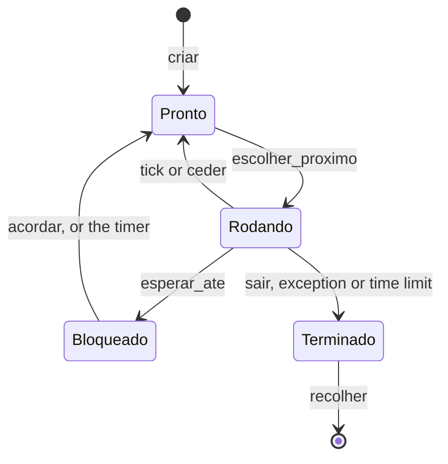

# 15: Sleeping and blocked processes

> **You will understand:** what **busy waiting** is and why it wastes the
> CPU; the **Blocked** state, which takes a process out of the round robin
> until someone **wakes it up**; the **`dormir`** (sleep) syscall; why every
> system needs an **idle process**; and the classic **lost wakeup** bug,
> which this chapter triggers on purpose to show how it happens and how it is
> avoided.
>
> **Files:** `src/escalonador.rs` (`Bloqueado` state, `Motivo`, idle process,
> `esperar_ate`, `acordar`, `dormir`), `src/interrupcoes/teclado.rs` (the
> handler wakes the shell up), `src/shell.rs` (the loop blocks; `ps` shows
> the reason), `src/usuario/mod.rs` (syscall 4, `dormir`), `programas/src/lib.rs`
> (`sos::dormir`), `programas/src/bin/soneca.rs` and `insone.rs` (new)
> **Book:** chapter 11, section 11.4 (the book stops at preemptive switching;
> the blocking states are ours)
> **Try it:** `./run.sh`, then `rodar soneca &`, `ps` and `rodar insone`;
> `./run.sh teste-acordar-perdido`; `cargo test --target x86_64-unknown-uefi`
> **Read first:** doc 08 (`hlt` and `teclado::esperar`), doc 12 (the scheduler)
> **New Rust here:** `impl Fn` (a closure called several times), enum variants
> with named fields and arithmetic that does not overflow
> ([§45](rust-basico.md#45-impl-fn-variants-with-fields-and-arithmetic-that-does-not-overflow))
>
> **Code for this chapter:** [state at the end of doc 15](https://github.com/moises-dev-git/siliconOS/tree/doc-15) · [what changed since doc 14](https://github.com/moises-dev-git/siliconOS/compare/doc-14...doc-15) · map in [Changes to the files](#changes-to-the-files)

Names in the code are in Portuguese: `dormir` = sleep, `acordar` = wake up,
`esperar_ate` = wait until, `bloqueado` = blocked, `ocioso` = idle, `motivo`
= reason, `teclado` = keyboard, `soneca` = nap, `insone` = sleepless.

---

## 1. The problem: waiting by burning the CPU

Up to doc 14, a program that wanted to wait half a second had only one way
to do it: ask for the time over and over.

```rust
let fim = sos::tiques() + 50; // 50 ticks = 500 ms
while sos::tiques() < fim {}
```

This is called **busy waiting**. The program does nothing useful, but to the
doc 12 scheduler it is `Pronto` (ready) like any other: it gets its slice of
CPU every round and burns all of it asking "is it time yet?". On a machine
with other processes, it steals their time; on an idle machine, it keeps the
CPU from stopping (and a laptop from saving battery).

The kernel had the same problem in two places:

- **`escalonador::esperar(pid)`**, which the shell uses to wait for a
  foreground program, was a loop of "has it finished? no: `ceder()`" (yield).
  The shell stayed in the round robin, waking up on every tick just to check.
- **The shell loop** slept with `hlt` (`teclado::esperar`, doc 08) only when
  nobody else was ready; with some program running, it stayed in the round
  robin, yielding on every tick.

What is missing is a way to tell the scheduler: **"don't give me the CPU
until X happens"**.

---

## 2. The idea: block and wake up

Every operating system solves this with one more state. Besides `Pronto`
(ready), `Rodando` (running) and `Terminado` (finished), a process can be
**Bloqueado** (blocked): waiting for something, out of the round robin. It
only becomes `Pronto` again when someone **wakes it up**: whoever made the
thing happen.



Each block has a **reason** (`Motivo`), and each reason has someone in charge
of waking up:

| Reason | Who blocks | Who wakes up |
|---|---|---|
| `Dormindo { ate }` (sleeping until) | a program (the `dormir` syscall) or the kernel (`escalonador::dormir`) | the **timer**, when tick `ate` arrives |
| `Teclado` (keyboard) | the shell, with no key to read | the **keyboard handler**, when a key arrives (and `encerrar`, when a background program ends) |
| `Processo(pid)` | whoever waits for process `pid` to end (`esperar`) | **`encerrar`**, when `pid` ends |

In the literature this goes by several names: *sleep/wakeup* in the original
Unix, *wait queues* in Linux, *condition variables* in concurrent
programming. The idea is the same: whoever waits does not ask; they are told.

### 2.1 Who runs when everyone is blocked?

With the shell waiting for a key and the programs sleeping, **nobody** is
ready. But the CPU cannot "run nothing": it always executes some
instruction. The scheduler needs someone to switch to.

The classic answer is the **idle process**: a kernel process that never
blocks and only does `hlt` (doc 08), the instruction that stops the CPU until
the next interrupt. In Linux it is pid 0 (the `swapper`); in Windows, the
"System Idle Process", which the Task Manager shows with the time the CPU
sat stopped. In SiliconOS it is **pid 1**, and the `ps` command shows its
ticks too: how long the CPU has been stopped since boot.

---

## 3. The code: the new states

In `src/escalonador.rs`, `Estado` gets one more variant, and there is a new
type for the reason:

```rust
pub enum Estado {
    /// Can run; waiting for its turn.
    Pronto,
    /// It is the process on the CPU now.
    Rodando,
    /// Waiting for something (doc 15). Out of the round robin until woken up.
    Bloqueado(Motivo),
    /// Finished; waiting for someone to collect the result and free the memory.
    Terminado(Resultado),
}

/// What a blocked process is waiting for (doc 15).
pub enum Motivo {
    /// Sleeping until timer tick `ate` (the `dormir` syscall).
    Dormindo { ate: u64 },
    /// A key (the shell). Also woken up when a background process ends,
    /// so the shell can reap its memory.
    Teclado,
    /// Process `Pid` to end (`esperar`).
    Processo(Pid),
}
```

(`Dormindo { ate: u64 }` is a variant with a **named** field, like a struct;
see [§45](rust-basico.md#45-impl-fn-variants-with-fields-and-arithmetic-that-does-not-overflow).)
Both enums derive `PartialEq`, so you can ask
`p.estado == Estado::Bloqueado(Motivo::Teclado)` directly.

---

## 4. The idle process

The idle process is created in `escalonador::init`, right after process 0:

```rust
pub fn init() {
    // The idle process's stack, fabricated like the others' (see `criar`),
    // but the `ret` of the first `trocar` lands straight in `laco_ocioso`,
    // in ring 0.
    let mut pilha = alloc::vec![0u64; TAM_PILHA_OCIOSO / 8].into_boxed_slice();
    let n = pilha.len();
    pilha[n - 1] = laco_ocioso as *const () as u64;
    let rsp_ocioso = &pilha[n - 7] as *const u64 as u64;
    // ... pushes process 0 ("kernel") and 1 ("ocioso", Pronto) into the table
}

#[unsafe(naked)]
unsafe extern "sysv64" fn laco_ocioso() -> ! {
    naked_asm!(
        "2:",
        "sti",
        "hlt",
        "jmp 2b",
    )
}
```

It is the same trick as doc 12 for a new process: a **fabricated** stack, as
if the process had already run and called `trocar` (switch). The difference
is what lies under the 6 registers. In a user program, it is
`primeira_entrada` plus an `iretq` frame to ring 3. In the idle process, it is
the address of `laco_ocioso` directly: `trocar`'s `ret` lands there, in ring 0.

```
  idle process's stack (4 KiB)

  top ─►  [ laco_ocioso      ]   return address of `trocar`
          [ r15 r14 ... rbx  ]   6 zeros  ◄─ saved rsp (n - 7)
          [ ...              ]   room for the interrupts
```

The loop has three instructions. `trocar` always runs with interrupts off
(inside `ceder`), so the idle process starts with IF=0: `sti` turns them
back on, and `hlt` stops the CPU. When an interrupt arrives, the handler runs
**on the idle process's stack** (it is in ring 0, so the CPU does not switch
stacks); if the handler switches processes, the idle process stays stopped in
there until next time. When it comes back, the handler's `iretq` returns it to
just after `hlt`, and the `jmp` starts over.

Why `naked`? Because there is no Rust code: no variables, no calls, so it
does not matter whether the stack is aligned to 16 bytes as the calling
convention would require.

### 4.1 When to choose the idle process

`escolher_proximo` (choose next, doc 12) does round robin among the ready
ones. Now it skips the idle process, and only chooses it when there is nobody
else **and** the current one cannot go on:

```rust
fn escolher_proximo() -> Option<(*mut u64, u64)> {
    let mut t = TABELA.lock();
    let n = t.processos.len();
    let atual = t.atual;
    let pronto = (1..n).map(|d| (atual + d) % n)
        .find(|&i| i != OCIOSO && t.processos[i].estado == Estado::Pronto);
    let proximo = match pronto {
        Some(i) => i,
        None if t.processos[atual].estado == Estado::Rodando => return None,
        None => OCIOSO,
    };
    if proximo == atual {
        return None;
    }
    // ... from here down, the same as doc 12
```

The three cases of the `match`:

1. Someone else is ready: switch to them (the usual round robin).
2. Nobody else is ready, but the current one is still `Rodando`: keep it
   (`None` = "don't switch").
3. Nobody is ready and the current one **cannot** go on (it has just blocked
   or finished): go to the idle process.

`if proximo == atual` covers the idle process in case 3: if it is the one
running, there is nowhere to switch to.

### 4.2 What if there were no idle process?

To see that it is needed, I temporarily replaced `None => OCIOSO` with
`None => return None`. The machine boots, prints `silicon> ` and **hangs**:
the `a` key sent through the QEMU monitor never shows up. The monitor's
`info registers` shows why:

```
RIP=0000000005febffe RFL=00000097 [--S-APC] CPL=0 II=0 A20=1 SMM=0 HLT=0
```

RFLAGS = 0x97: the IF bit (0x200) is **off**, and `HLT=0`: the CPU is not
stopped, it is spinning. The shell blocked, `escolher_proximo` said "don't
switch", and `esperar_ate` (section 5) went back to checking the condition,
again and again, with interrupts off. The key is never delivered, and the
condition never becomes true. With the idle process, there is always someone
to switch to, and it is the one that turns interrupts back on.

---

## 5. Blocking without losing the notice: `esperar_ate`

Every wait has the same shape: "while the condition is not true, sleep". The
naive way of writing that has a flaw worth understanding, because it shows up
in all concurrent code:

```
  shell                                    keyboard handler
  ─────                                    ────────────────
  is the queue empty? yes
                       ◄── key arrives ──  puts it in the queue
                                           wakes up whoever waits for a
                                           key: nobody (the shell is not
                                           blocked yet)
  blocks: Bloqueado(Teclado)
  ... sleeps, with a key in the queue
```

This is the **lost wakeup**: the notice arrived **between** "checked" and
"went to sleep", and was lost. The shell stays blocked waiting for something
that already happened, until another key wakes it up.

The fix is not to let the handler run in that gap: check the condition and
mark the process as blocked **with interrupts off**, all at once:

```rust
pub fn esperar_ate(motivo: Motivo, condicao: impl Fn() -> bool) {
    cpu::sem_interrupcoes(|| {
        while !condicao() {
            bloquear_e_trocar(motivo);
        }
    });
}

fn bloquear_e_trocar(motivo: Motivo) {
    {
        let mut t = TABELA.lock();
        let a = t.atual;
        assert!(a != OCIOSO, "o ocioso nunca bloqueia");
        t.processos[a].estado = Estado::Bloqueado(motivo);
    }
    if let Some((salvar, novo_rsp)) = escolher_proximo() {
        unsafe { trocar(salvar, novo_rsp) };
    }
}
```

Step by step:

1. With interrupts off, check the condition. If it is already true, return
   without blocking.
2. Otherwise, mark the current process as `Bloqueado(motivo)` and switch
   processes. Interrupts stay off until `trocar`: no handler runs between
   step 1 and this one. If the key arrives now, it stays **pending** in the
   APIC and is only delivered after the switch, when the handler will find
   the shell blocked and wake it up.
3. When someone wakes the process up and its turn comes, `trocar` "returns"
   and the `while` checks the condition **again**. This matters: being woken
   up means "it may have changed", not "it changed". For example, the shell
   is also woken up when a background program ends, with no key at all.

The condition is a closure, `impl Fn() -> bool`: `Fn`, and not `FnOnce` as
in `sem_interrupcoes` (doc 08), because it is called several times
([§45](rust-basico.md#45-impl-fn-variants-with-fields-and-arithmetic-that-does-not-overflow)).

This is the same problem doc 08 had already solved, on a small scale, in
`teclado::esperar`: `cli`, check the queue, and `sti; hlt` together, because
the CPU only accepts interrupts after the instruction that follows `sti`.
There the "switch" was `hlt`; here it is `trocar`. The rule is the same:
**the check and the "going to sleep" must be one single thing, with no gap
for the notice**.

### 5.1 Waking up

```rust
pub fn acordar(motivo: Motivo) -> usize {
    cpu::sem_interrupcoes(|| acordar_em(&mut TABELA.lock(), motivo))
}

fn acordar_em(t: &mut Tabela, motivo: Motivo) -> usize {
    let mut n = 0;
    for p in t.processos.iter_mut().filter(|p| p.estado == Estado::Bloqueado(motivo)) {
        p.estado = Estado::Pronto;
        n += 1;
    }
    n
}
```

Waking up only changes the state to `Pronto`; who runs is decided by the
scheduler, as always. `acordar` can be called from inside an interrupt
handler, and that is safe because of the doc 12 rule: **every kernel lock is
taken with interrupts off**. On a single CPU, that means that if a handler is
running, nobody is holding the table's lock. (`acordar_em` exists for
`encerrar`, which already holds the lock and cannot take it again.)

### 5.2 The bug on purpose: `teste-acordar-perdido`

To watch the lost wakeup happen, the `teste-acordar-perdido` feature puts,
inside the `while` of `esperar_ate`, between checking and blocking, a
3-second window with interrupts on:

```rust
#[cfg(feature = "teste-acordar-perdido")]
fn janela_do_acordar_perdido() {
    let fim = timer::tiques() + 3 * timer::FREQUENCIA_HZ;
    crate::kprint!("[janela aberta no tique {}]", timer::tiques());
    while timer::tiques() < fim {
        cpu::ligar_interrupcoes();
        unsafe { core::arch::asm!("hlt") };
        cpu::desligar_interrupcoes();
    }
    crate::kprint!("[janela fechada no tique {}: bloqueando]", timer::tiques());
}
```

With `./run.sh teste-acordar-perdido`, I pressed `a` one second after the
window opened (*janela aberta*) and waited 4 seconds. The serial port showed
only this (*janela fechada... bloqueando* = window closed... blocking):

```
silicon> [janela aberta no tique 3][janela fechada no tique 303: bloqueando]
```

The `a` did not show up, even though it had been in the queue since tick
~100. When I pressed `b`:

```
silicon> [janela aberta no tique 3][janela fechada no tique 303: bloqueando]ab[janela aberta no tique 507]
```

The `b` woke the shell up, and both letters came out together. Without the
feature, the same script shows the `a` right away. In a real system the
window lasts a few nanoseconds, not 3 seconds: the bug happens once in a
thousand times, and nobody can reproduce it. That is why the window is closed
by construction.

---

## 6. The three that wait

### 6.1 The shell waits for a key

The shell loop (`src/shell.rs`) stops checking whether others are ready and
simply blocks:

```rust
loop {
    while let Some(scancode) = teclado::proximo_scancode() {
        // ... translates and handles the key, as in doc 09
    }
    escalonador::recolher_segundo_plano();
    escalonador::esperar_ate(Motivo::Teclado, || {
        teclado::tem_scancode() || escalonador::ha_terminados_em_segundo_plano()
    });
}
```

The condition has two parts because the shell has two jobs: reading keys and
reaping the memory of background programs that finished (doc 12).
`teclado::tem_scancode` ("has a scancode") replaces doc 08's `teclado::esperar`.

The keyboard handler, after putting the byte in the queue and sending the
EOI, wakes up whoever waits for a key:

```rust
    apic::eoi();

    // Wake up whoever waits for a key (the shell, doc 15) and give it the
    // turn right away: without this, the key would only show up on the next
    // tick (up to 10 ms later).
    if escalonador::acordar(Motivo::Teclado) > 0 {
        escalonador::ceder();
    }
```

The `ceder` (yield) is the same one the timer does (doc 12), and for the same
reason it comes after the EOI. Without it, the shell would be `Pronto`, but
the CPU would stay with whoever was running (almost always the idle process,
stopped in `hlt`) until the next tick. I measured this with temporary
instrumentation (the `rdtsc` cycle counter read in the handler and again when
the shell takes the key), under KVM, where the counter runs at 2.6 GHz:

| | cycles between the interrupt and the shell |
|---|---|
| with `ceder` | 98 to 183 thousand (under 0.1 ms) |
| without `ceder` | 0.17 to 23.8 million (up to ~9 ms: what was left until the next tick) |

### 6.2 `esperar` waits for a process

```rust
pub fn esperar(pid: Pid) -> Resultado {
    esperar_ate(Motivo::Processo(pid), || terminou(pid));
    recolher(pid).unwrap_or_else(|| panic!("esperar: o processo {} nao existe", pid))
}
```

And `encerrar` (terminate), when it marks a process as `Terminado`, wakes up
whoever was waiting for it (and the shell, if it was a background one):

```rust
        p.estado = Estado::Terminado(resultado);
        let (pid, nome, segundo_plano) = (p.pid, p.nome, p.segundo_plano);
        acordar_em(&mut t, Motivo::Processo(pid));
        if segundo_plano {
            acordar_em(&mut t, Motivo::Teclado);
        }
```

### 6.3 A program sleeps: the `dormir` syscall

The timer already goes through `escalonador::tique` 100 times per second; now
it also wakes up whoever slept until the current tick (and counts the idle
process's ticks):

```rust
pub fn tique(quadro: &QuadroInterrupcao) {
    let agora = timer::tiques();
    cpu::sem_interrupcoes(|| {
        let mut t = TABELA.lock();
        for p in t.processos.iter_mut() {
            if let Estado::Bloqueado(Motivo::Dormindo { ate }) = p.estado {
                if agora >= ate {
                    p.estado = Estado::Pronto;
                }
            }
        }
        if t.atual == OCIOSO {
            t.processos[OCIOSO].tiques_cpu += 1;
        }
    });
    // ... the rest, the same as doc 12 (CPU time, limit, ceder)
```

Sleeping is just blocking with the condition "tick `ate` has arrived":

```rust
pub fn dormir(tiques: u64) {
    let ate = timer::tiques() + tiques;
    esperar_ate(Motivo::Dormindo { ate }, || timer::tiques() >= ate);
}
```

Syscall number 4 takes milliseconds and rounds them **up** to ticks, so that
asking for 1 ms sleeps one tick, not zero:

```rust
fn dormir(ms: u64) -> u64 {
    escalonador::dormir(ms_para_tiques(ms));
    0
}

fn ms_para_tiques(ms: u64) -> u64 {
    ms.saturating_mul(timer::FREQUENCIA_HZ).div_ceil(1000)
}
```

(`saturating_mul` does not overflow with an absurd `ms` coming from the
program; see
[§45](rust-basico.md#45-impl-fn-variants-with-fields-and-arithmetic-that-does-not-overflow).)

Sleeping **inside a syscall** works with nothing special: the call arrives on
the process's kernel stack (doc 12 and doc 14), and `trocar` saves that stack
like any other. When the process wakes up, it returns from `trocar`, from
`esperar_ate`, from `tratar_syscall` and finally from `sysretq`, as if the
syscall had just taken a while.

In the `sos` library:

```rust
const SYS_DORMIR: u64 = 4;

pub fn dormir(ms: u64) {
    chamada(SYS_DORMIR, ms, 0);
}
```

### 6.4 Two programs to compare

`programas/src/bin/soneca.rs` wakes up 5 times, once every half second,
sleeping in between (*acordei, vez* = I woke up, time):

```rust
fn main() -> u64 {
    let pid = sos::pid();
    for vez in 1..=5 {
        println!("soneca (pid {}): acordei, vez {} (tique {})", pid, vez, sos::tiques());
        sos::dormir(500);
    }
    0
}
```

`programas/src/bin/insone.rs` does the same, but waits the old way, with the
busy waiting from section 1.

---

## 7. How it was tested

### 7.1 From the shell

`ps` shows the idle process and the reason for each block (*dormindo ate* =
sleeping until). With `rodar soneca &` followed by `ps` (the `soneca` lines
get mixed with what I was typing, because it prints in the background):

```
silicon> rodar soneca &
[2] 'soneca' em segundo plano
soneca (pid 2): acordei, vez 1 (tique 559)
soneca (pid 2): acordei, vez 2 (tique 611)
soneca (pid 2): acordei, vez 3 (tique 662)
ps
  PID  ESTADO               CPU (tiques)  NOME
    0  rodando                         0  kernel
    1  pronto                        651  ocioso
    2  dormindo ate 714                4  soneca
silicon> soneca (pid 2): acordei, vez 4 (tique 714)
soneca (pid 2): acordei, vez 5 (tique 766)

[2] 'soneca' terminou: codigo de saida 0
```

The idle process already had 651 ticks: since boot, the CPU sat stopped
almost all the time. `soneca` had used **4** CPU ticks in the ~130 ticks
(1.3 s) it had been alive. It wakes up every 51 or 52 ticks, not 50, because
the interval is "print the line + sleep 50 ticks", and in QEMU without KVM
printing is slow: with KVM, the measured intervals were exactly 50, 50, 50
and 50.

`insone`, the old way:

```
silicon> rodar insone
insone (pid 3): acordei, vez 1 (tique 1604)
insone (pid 3): acordei, vez 2 (tique 1656)
insone (pid 3): acordei, vez 3 (tique 1706)
insone (pid 3): acordei, vez 4 (tique 1756)
'insone' encerrado pelo kernel: usou 2 s de CPU sem terminar
```

It never reaches the fifth time: in 2 seconds it used up the 200 CPU ticks the
kernel allows (doc 12's `LIMITE_TIQUES`), and was terminated (*encerrado pelo
kernel: usou 2 s de CPU sem terminar* = terminated by the kernel: used 2 s of
CPU without finishing) as if it were in an infinite loop. From the kernel's
point of view, **it was**: busy waiting and an infinite loop look exactly
the same.

### 7.2 How hard the real CPU works

QEMU is a Linux program, and its CPU time shows up in
`/proc/<pid>/task/*/stat`. I measured the thread that runs the virtual CPU,
in 1.5 s windows (two rounds of each, with the same result):

| Situation | TCG (no KVM) | KVM |
|---|---|---|
| shell waiting for a key, nothing else | 1% | 1% |
| `soneca` running | 5% | 2% |
| `insone` running | **100%** | **100%** |

`soneca` and `insone` do the same thing seen from outside. One of them keeps
a core of the real machine busy all the time.

### 7.3 `cargo test`

Five new tests, 53 in total, all passing:

```
siliconos::escalonador::testes::insone_gasta_a_cpu_e_e_encerrado ... insone (pid 6): acordei, vez 1 (tique 662)
insone (pid 6): acordei, vez 2 (tique 713)
insone (pid 6): acordei, vez 3 (tique 763)
insone (pid 6): acordei, vez 4 (tique 813)
(0 tiques com a CPU parada) [ok]
siliconos::escalonador::testes::o_kernel_dorme_e_a_cpu_fica_parada ... (20 tiques, 20 com a CPU parada) [ok]
siliconos::escalonador::testes::o_kernel_e_o_processo_zero ... [ok]
siliconos::escalonador::testes::o_ocioso_e_o_processo_um ... [ok]
...
siliconos::escalonador::testes::soneca_dorme_sem_gastar_cpu ... soneca (pid 8): acordei, vez 1 (tique 893)
...
(258 tiques, 250 com a CPU parada) [ok]
...
siliconos::usuario::testes::milissegundos_viram_tiques_para_cima ... [ok]
Todos os 53 testes passaram.
```

`o_kernel_dorme_e_a_cpu_fica_parada` ("the kernel sleeps and the CPU stays
stopped") is process 0 (the one running the tests) calling
`escalonador::dormir(20)`: during those 20 ticks, the idle process ran. In the
`soneca` and `insone` tests, the kernel waits for the program with `esperar`,
blocked; so the idle process's ticks measure how long the CPU sat stopped
**while the program existed** (*com a CPU parada* = with the CPU stopped):
250 of 258 with `soneca`, 0 with `insone`.

The doc 12 tests (`dois_contadores_ao_mesmo_tempo`, 252 ticks;
`dois_lacos_dividem_a_cpu`, 400 ticks) still pass with the same numbers:
blocking did not change the round robin among the ready ones.

### 7.4 Regression

The 24 builds (the normal one and the 23 test and diagnostic features from
the earlier chapters) behave as before: each triggered exception shows up
with the same message, the memory, heap and timer tests print "OK", and
`teste-deadlock` hangs on purpose.

---

## What is still missing

- **Programs do not read the keyboard.** Only the shell waits for a key. A
  `ler` (read) syscall blocking with `Motivo::Teclado` would be small; the
  problem is deciding **who** gets the key when two programs are waiting,
  which leads to the idea of a terminal and of a "foreground" process.
- **`acordar` walks the whole table.** With 5 processes, it makes no
  difference; with thousands, Linux uses one queue per reason (*wait queue*),
  and the timer keeps the sleepers sorted by deadline.
- **The timer wakes the CPU up 100 times per second**, even with everything
  stopped. Modern systems program the next tick for the next deadline
  (*tickless*), and the idle process really sleeps for longer.
- **A single CPU.** With several, turning interrupts off is not enough to
  close the lost wakeup window: another CPU may be touching the table at the
  same time. That is where real spinlocks (and `swapgs`) come in.

---

## Changes to the files

What this chapter adds to the doc 14 code (tag `doc-14`). Each file's link
goes to its state at the end of this chapter (tag `doc-15`); every changed
line is in the [comparison between the two tags](https://github.com/moises-dev-git/siliconOS/compare/doc-14...doc-15).

| File | What changes | Where |
|---|---|---|
| [`src/escalonador.rs`](https://github.com/moises-dev-git/siliconOS/blob/doc-15/src/escalonador.rs) | `Estado::Bloqueado`, `Motivo`, `OCIOSO`; `init` creates the idle process; `laco_ocioso`; `escolher_proximo` skips the idle process (section 4.1); `tique` wakes sleepers up; `encerrar` wakes up whoever waits; `esperar` blocks; `esperar_ate`, `bloquear_e_trocar`, `acordar`, `acordar_em`, `dormir`, `terminou`, `ha_terminados_em_segundo_plano`, `janela_do_acordar_perdido`; `ha_outros_prontos` goes away; 4 tests | — |
| [`src/interrupcoes/teclado.rs`](https://github.com/moises-dev-git/siliconOS/blob/doc-15/src/interrupcoes/teclado.rs) | the handler wakes up and yields (section 6.1); `tem_scancode` instead of `fila_vazia` and `esperar` | end of `tratador`; where `esperar` was |
| [`src/shell.rs`](https://github.com/moises-dev-git/siliconOS/blob/doc-15/src/shell.rs) | the loop in `rodar` blocks (section 6.1); `ps` shows the reason | `rodar`; `ps` |
| [`src/usuario/mod.rs`](https://github.com/moises-dev-git/siliconOS/blob/doc-15/src/usuario/mod.rs) | `SYS_DORMIR`, `dormir`, `ms_para_tiques`; 1 test | constants; `tratar_syscall`; before `escrever` |
| [`programas/src/lib.rs`](https://github.com/moises-dev-git/siliconOS/blob/doc-15/programas/src/lib.rs) | `SYS_DORMIR` and `dormir` | constants; before `Console` |
| [`programas/src/bin/soneca.rs`](https://github.com/moises-dev-git/siliconOS/blob/doc-15/programas/src/bin/soneca.rs), [`insone.rs`](https://github.com/moises-dev-git/siliconOS/blob/doc-15/programas/src/bin/insone.rs) | **new** (section 6.4) | — |
| [`src/ramdisk.rs`](https://github.com/moises-dev-git/siliconOS/blob/doc-15/src/ramdisk.rs) | tests: 6 names; the damaged-tar count compares with `arquivos().count()` | tests |
| [`Cargo.toml`](https://github.com/moises-dev-git/siliconOS/blob/doc-15/Cargo.toml) | `teste-acordar-perdido` feature | `[features]`, at the end |

### The pieces the text did not show

The new `use` in `escalonador.rs`, the idle constant and the tick count in
`Processo`:

```rust
use crate::interrupcoes::timer;

/// Index and pid of the idle process: always the second one in the table.
const OCIOSO: usize = 1;

    /// Timer ticks that caught this process in ring 3 (in the idle process:
    /// the ticks in which the CPU was stopped, since doc 15).
    pub tiques_cpu: u64,
```

The end of `init` and the stack constant:

```rust
        t.processos.push(Box::new(Processo {
            pid: 1, nome: "ocioso", estado: Estado::Pronto, rsp: rsp_ocioso,
            pilha: Some(pilha), espaco: None, tiques_cpu: 0, segundo_plano: false,
        }));
        t.proximo_pid = 2;
    });
}

/// The idle process's stack: it only receives the frames of the interrupts
/// that wake it up.
const TAM_PILHA_OCIOSO: usize = 4 * 1024;
```

`esperar_ate` with the feature call, and the two helpers:

```rust
pub fn esperar_ate(motivo: Motivo, condicao: impl Fn() -> bool) {
    cpu::sem_interrupcoes(|| {
        while !condicao() {
            #[cfg(feature = "teste-acordar-perdido")]
            janela_do_acordar_perdido();
            bloquear_e_trocar(motivo);
        }
    });
}

fn terminou(pid: Pid) -> bool {
    cpu::sem_interrupcoes(|| {
        let t = TABELA.lock();
        t.processos.iter().find(|p| p.pid == pid).is_none_or(|p| matches!(p.estado, Estado::Terminado(_)))
    })
}

pub fn ha_terminados_em_segundo_plano() -> bool {
    cpu::sem_interrupcoes(|| {
        let t = TABELA.lock();
        t.processos.iter().any(|p| p.segundo_plano && matches!(p.estado, Estado::Terminado(_)))
    })
}
```

In `teclado.rs`:

```rust
use crate::escalonador::{self, Motivo};

pub fn tem_scancode() -> bool {
    LEITURA.load(Ordering::Relaxed) != ESCRITA.load(Ordering::Acquire)
}
```

In `shell.rs`, the `use` becomes `use crate::escalonador::{self, Motivo};`, and `ps`:

```rust
fn ps(_: &[&str]) {
    use crate::escalonador::Estado;
    use alloc::format;
    kprintln!("  PID  ESTADO               CPU (tiques)  NOME");
    for (pid, nome, estado, tiques) in escalonador::listar() {
        let estado = match estado {
            Estado::Pronto => format!("pronto"),
            Estado::Rodando => format!("rodando"),
            Estado::Bloqueado(Motivo::Dormindo { ate }) => format!("dormindo ate {}", ate),
            Estado::Bloqueado(Motivo::Teclado) => format!("esperando tecla"),
            Estado::Bloqueado(Motivo::Processo(p)) => format!("esperando pid {}", p),
            Estado::Terminado(_) => format!("terminado"),
        };
        kprintln!("  {:>3}  {:<19}  {:>12}  {}", pid, estado, tiques, nome);
    }
}
```

In `usuario/mod.rs`, `pub const SYS_DORMIR: u64 = 4;` after `SYS_PID`, and in
the `match` of `tratar_syscall`, `SYS_DORMIR => dormir(r.rdi),`. The test:

```rust
    #[test_case]
    fn milissegundos_viram_tiques_para_cima() {
        assert_eq!(ms_para_tiques(0), 0);
        assert_eq!(ms_para_tiques(1), 1);
        assert_eq!(ms_para_tiques(10), 1);
        assert_eq!(ms_para_tiques(11), 2);
        assert_eq!(ms_para_tiques(500), 50);
        assert_eq!(ms_para_tiques(u64::MAX), u64::MAX.div_ceil(1000));
    }
```

The new tests in `escalonador.rs` (before `processo_terminado_devolve_pilha_e_quadros`):

```rust
    /// Ticks of stopped CPU (the idle process's) so far.
    fn tiques_ociosos() -> u64 {
        listar()[OCIOSO].3
    }

    fn rodar_do_disco(nome: &str) -> Resultado {
        let arquivo = crate::ramdisk::abrir(nome).unwrap();
        esperar(usuario::iniciar_elf(arquivo.nome, arquivo.dados, false).unwrap())
    }

    #[test_case]
    fn o_ocioso_e_o_processo_um() {
        let lista = listar();
        assert_eq!((lista[OCIOSO].0, lista[OCIOSO].1), (1, "ocioso"));
        assert_eq!(lista[OCIOSO].2, Estado::Pronto);
    }

    #[test_case]
    fn o_kernel_dorme_e_a_cpu_fica_parada() {
        let (inicio, ocioso) = (timer::tiques(), tiques_ociosos());
        dormir(20);
        let (passou, parada) = (timer::tiques() - inicio, tiques_ociosos() - ocioso);
        crate::kprint!("({} tiques, {} com a CPU parada) ", passou, parada);
        assert!((20..=21).contains(&passou), "dormiu {} tiques", passou);
        assert!(parada >= 19, "so {} tiques ociosos", parada);
    }

    #[test_case]
    fn soneca_dorme_sem_gastar_cpu() {
        let (inicio, ocioso) = (timer::tiques(), tiques_ociosos());
        assert_eq!(rodar_do_disco("soneca"), Resultado::Saiu(0));
        let (passou, parada) = (timer::tiques() - inicio, tiques_ociosos() - ocioso);
        crate::kprint!("({} tiques, {} com a CPU parada) ", passou, parada);
        assert!(passou >= 200, "levou so {} tiques", passou);
        assert!(parada * 10 >= passou * 9, "so {} de {} tiques ociosos", parada, passou);
    }

    #[test_case]
    fn insone_gasta_a_cpu_e_e_encerrado() {
        let ocioso = tiques_ociosos();
        assert_eq!(rodar_do_disco("insone"), Resultado::TempoEsgotado);
        let parada = tiques_ociosos() - ocioso;
        crate::kprint!("({} tiques com a CPU parada) ", parada);
        assert!(parada < 10, "{} tiques ociosos", parada);
    }
```

---

## Functions in this chapter

Every function this chapter adds, in one sentence each. The most important ones were explained in the text above; this table is a map and a quick reference. (Functions that already existed and only changed are listed in [Changes to the files](#changes-to-the-files).)

| Function | File | What it does |
|---|---|---|
| `laco_ocioso` | [escalonador.rs](https://github.com/moises-dev-git/siliconOS/blob/doc-15/src/escalonador.rs) | (naked) The idle process: `sti; hlt` forever; runs when nobody else can. |
| `esperar_ate` | [escalonador.rs](https://github.com/moises-dev-git/siliconOS/blob/doc-15/src/escalonador.rs) | Blocks the current process until the condition is true, checking it with interrupts off (no lost wakeup). |
| `bloquear_e_trocar` | [escalonador.rs](https://github.com/moises-dev-git/siliconOS/blob/doc-15/src/escalonador.rs) | Marks the current process as `Bloqueado(motivo)` and switches processes; returns when it is woken up and its turn comes. |
| `janela_do_acordar_perdido` | [escalonador.rs](https://github.com/moises-dev-git/siliconOS/blob/doc-15/src/escalonador.rs) | (only with `teste-acordar-perdido`) Turns interrupts on for 3 s between checking and blocking, to show the bug. |
| `acordar` | [escalonador.rs](https://github.com/moises-dev-git/siliconOS/blob/doc-15/src/escalonador.rs) | Sets every process blocked for the given reason to `Pronto` and returns how many; can be called from a handler. |
| `acordar_em` | [escalonador.rs](https://github.com/moises-dev-git/siliconOS/blob/doc-15/src/escalonador.rs) | The same as `acordar`, for code that already holds the table's lock (`encerrar`). |
| `dormir` | [escalonador.rs](https://github.com/moises-dev-git/siliconOS/blob/doc-15/src/escalonador.rs) | Blocks the current process for at least that many ticks, without using the CPU. |
| `terminou` | [escalonador.rs](https://github.com/moises-dev-git/siliconOS/blob/doc-15/src/escalonador.rs) | Has process `pid` finished (or does it not even exist)? The condition of `esperar`. |
| `ha_terminados_em_segundo_plano` | [escalonador.rs](https://github.com/moises-dev-git/siliconOS/blob/doc-15/src/escalonador.rs) | Is there a finished background process waiting to be reaped? (part of the shell's condition) |
| `tem_scancode` | [interrupcoes/teclado.rs](https://github.com/moises-dev-git/siliconOS/blob/doc-15/src/interrupcoes/teclado.rs) | Is there a scancode in the queue? Replaces `esperar` and `fila_vazia`. |
| `dormir` (syscall) | [usuario/mod.rs](https://github.com/moises-dev-git/siliconOS/blob/doc-15/src/usuario/mod.rs) | Syscall 4: sleeps `ms` milliseconds (rounded up to ticks); returns 0. |
| `ms_para_tiques` | [usuario/mod.rs](https://github.com/moises-dev-git/siliconOS/blob/doc-15/src/usuario/mod.rs) | Milliseconds to ticks, rounding up and without overflowing. |
| `dormir` (sos) | [programas/src/lib.rs](https://github.com/moises-dev-git/siliconOS/blob/doc-15/programas/src/lib.rs) | Calls the `dormir` syscall. |
| `main` (soneca) | [programas/src/bin/soneca.rs](https://github.com/moises-dev-git/siliconOS/blob/doc-15/programas/src/bin/soneca.rs) | Wakes up 5 times, every 500 ms, sleeping in between. |
| `main` (insone) | [programas/src/bin/insone.rs](https://github.com/moises-dev-git/siliconOS/blob/doc-15/programas/src/bin/insone.rs) | The same as `soneca`, but with busy waiting. |

Automated tests (`#[test_case]`, run with `cargo test`, see doc 09):

| Function | File | What it does |
|---|---|---|
| `tiques_ociosos` | [escalonador.rs](https://github.com/moises-dev-git/siliconOS/blob/doc-15/src/escalonador.rs) | Helper: the idle process's ticks so far (time with the CPU stopped). |
| `rodar_do_disco` | [escalonador.rs](https://github.com/moises-dev-git/siliconOS/blob/doc-15/src/escalonador.rs) | Helper: runs a program from the RAM disk and waits for the result. |
| `o_ocioso_e_o_processo_um` | [escalonador.rs](https://github.com/moises-dev-git/siliconOS/blob/doc-15/src/escalonador.rs) | Test: process 1 is "ocioso" and is `Pronto`. |
| `o_kernel_dorme_e_a_cpu_fica_parada` | [escalonador.rs](https://github.com/moises-dev-git/siliconOS/blob/doc-15/src/escalonador.rs) | Test: `dormir(20)` takes 20 or 21 ticks, almost all with the idle process running. |
| `soneca_dorme_sem_gastar_cpu` | [escalonador.rs](https://github.com/moises-dev-git/siliconOS/blob/doc-15/src/escalonador.rs) | Test: while `soneca` exists, the CPU stays stopped at least 90% of the time. |
| `insone_gasta_a_cpu_e_e_encerrado` | [escalonador.rs](https://github.com/moises-dev-git/siliconOS/blob/doc-15/src/escalonador.rs) | Test: `insone` never lets the CPU stop and is terminated for running out of time. |
| `milissegundos_viram_tiques_para_cima` | [usuario/mod.rs](https://github.com/moises-dev-git/siliconOS/blob/doc-15/src/usuario/mod.rs) | Test: 1 ms becomes 1 tick, 11 ms become 2, `u64::MAX` does not overflow. |

---

## Differences from the book

The book ends at preemptive process switching; blocking, the idle process and
the `dormir` syscall are ours. The choices: a `Bloqueado` state with a reason
(instead of separate wait queues), the idle process as an ordinary process in
the table (pid 1), and the condition checked with interrupts off, which is
only enough because there is a single CPU.

## Summary

- **Busy waiting** (asking over and over) burns the whole CPU: `insone`
  keeps a core of the real machine at 100% and is terminated by the CPU time
  limit. `soneca`, which sleeps, leaves the CPU stopped for 250 of 258 ticks.
- A **blocked** process is out of the round robin until it is **woken up** by
  whoever settles the reason: the timer (`Dormindo`), the keyboard handler
  (`Teclado`) or `encerrar` (`Processo`).
- The **idle process** (pid 1) runs when nobody else can: `sti; hlt`.
  Without it, the kernel would spin with interrupts off and the machine would
  hang (tested).
- `esperar_ate` checks the condition and blocks **with interrupts off**, and
  checks again on waking up. That closes the **lost wakeup** window, which
  `teste-acordar-perdido` opens on purpose: the key stays in the queue until
  another key arrives.
- The keyboard handler wakes the shell up and yields right away: the key
  reaches the shell in under 0.1 ms, instead of up to 10 ms.

<details>
<summary><b>Review (click to see the answers)</b></summary>

1. **Why can't the doc 12 scheduler tell `insone` apart from a useful
   program?**
   Because both are `Pronto` all the time: the scheduler only knows that they
   want the CPU, not what they do with it. Only the program itself knows that
   it is waiting, and that is why it has to tell the kernel (the `dormir`
   syscall).

2. **Who wakes up a `Dormindo` process? And one blocked on
   `Processo(5)`?**
   The first, the timer: on each tick, `tique` sets to `Pronto` whoever was
   sleeping until a tick that has already arrived. The second, `encerrar`,
   when process 5 ends.

3. **Why is there an idle process, instead of the scheduler simply "not
   switching" when nobody is ready?**
   Because the current process may have no way to go on: it has just blocked
   or finished. The CPU always executes something; the idle process is the
   harmless thing (`hlt`) it executes, and it is the one that turns interrupts
   back on. Without it, the kernel spun with IF=0 and the machine hung.

4. **Describe the lost wakeup with the shell and a key.**
   The shell checks the queue (empty). Before it marks itself as blocked, the
   key arrives: the handler puts it in the queue and tries to wake up whoever
   waits for a key, but nobody is blocked yet. Then the shell blocks, with a
   key in the queue, and only wakes up on the next key.

5. **How does `esperar_ate` avoid that, and why is that only enough with one
   CPU?**
   It checks the condition and marks the process as blocked with interrupts
   off: the handler cannot run in between. The interrupt stays pending and is
   delivered after the switch, when the process is already blocked. With
   several CPUs, another CPU could run the handler at the same time; a real
   lock around the check and the block would be needed.

6. **Why does `esperar_ate` check the condition again after waking up?**
   Because being woken up means "it may have changed". The shell, for
   example, is also woken up when a background program ends, with no key at
   all; and, with two processes waiting for the same thing, the first one to
   run may consume it before the second.

7. **Why does `dormir(1)` sleep one tick (10 ms) and not zero?**
   Because `ms_para_tiques` rounds up (`div_ceil`): 1 ms × 100 / 1000 = 0.1,
   which becomes 1. Rounding down would make the program not sleep at all,
   and a loop with `dormir(1)` would become busy waiting again.

</details>
