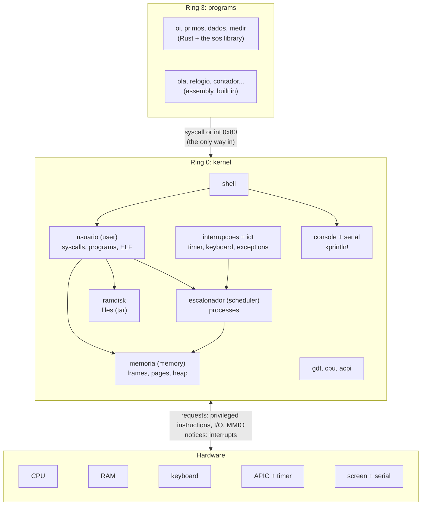
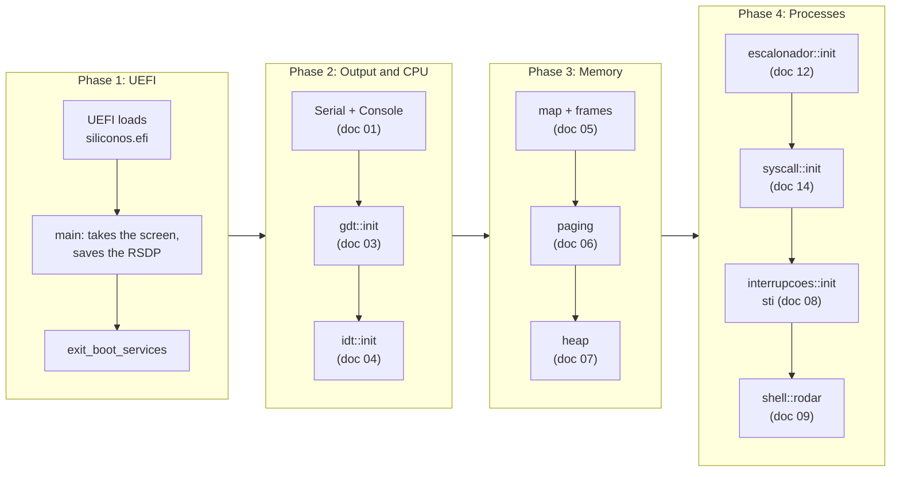
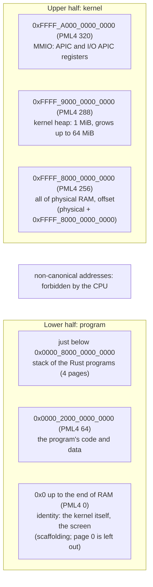
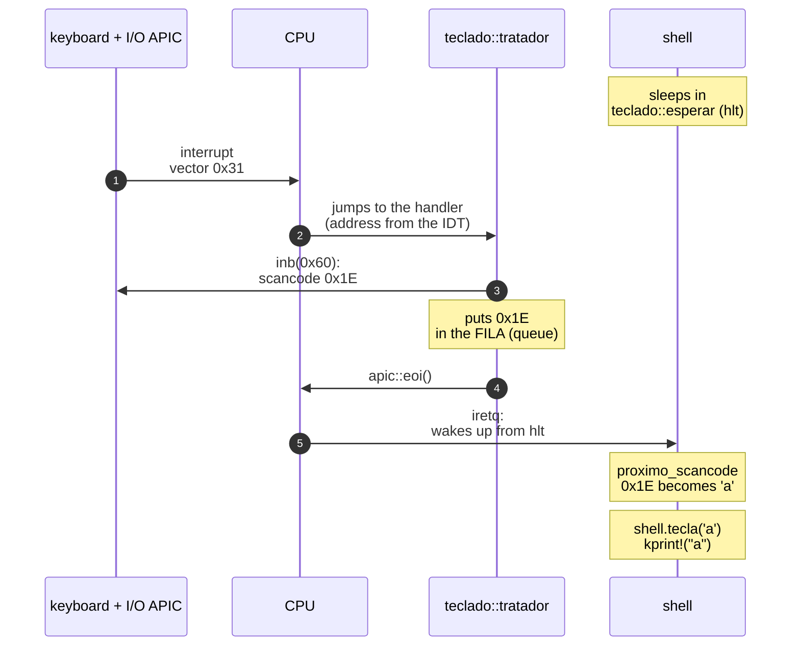
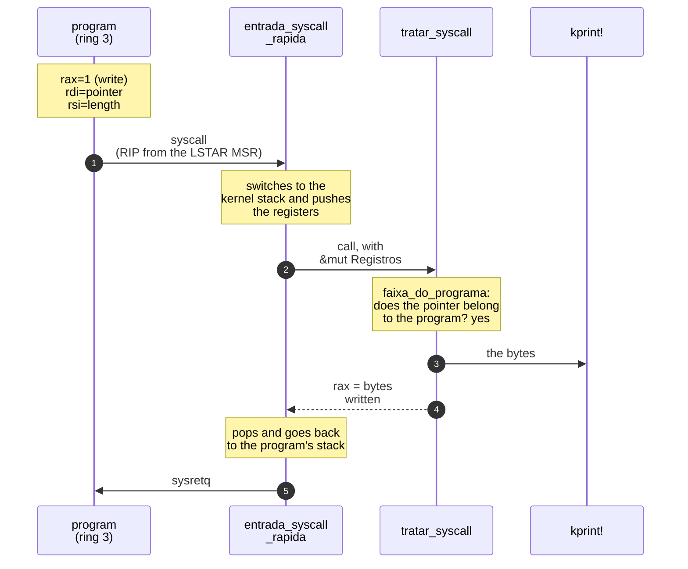
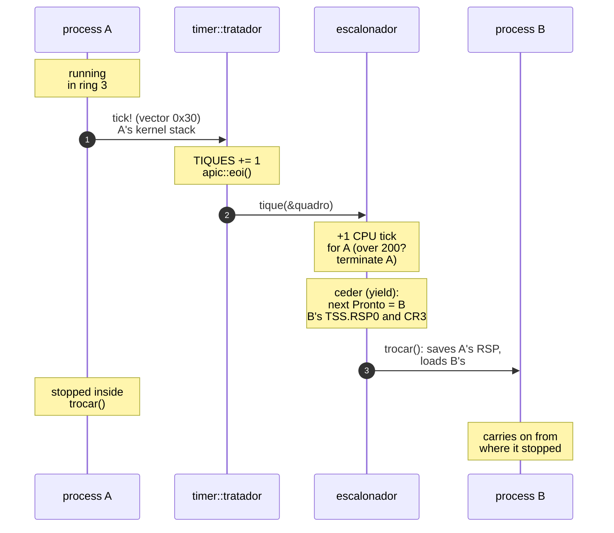
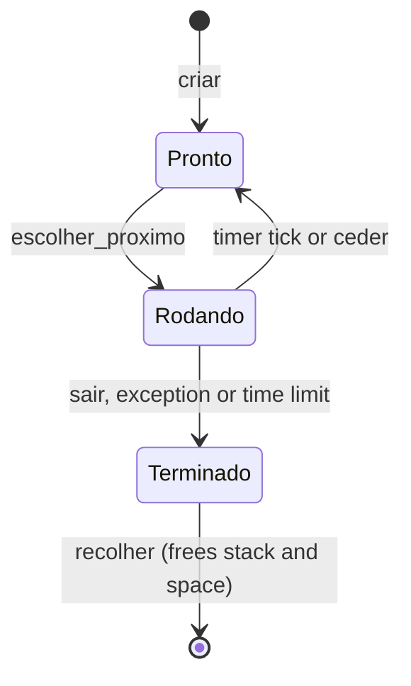
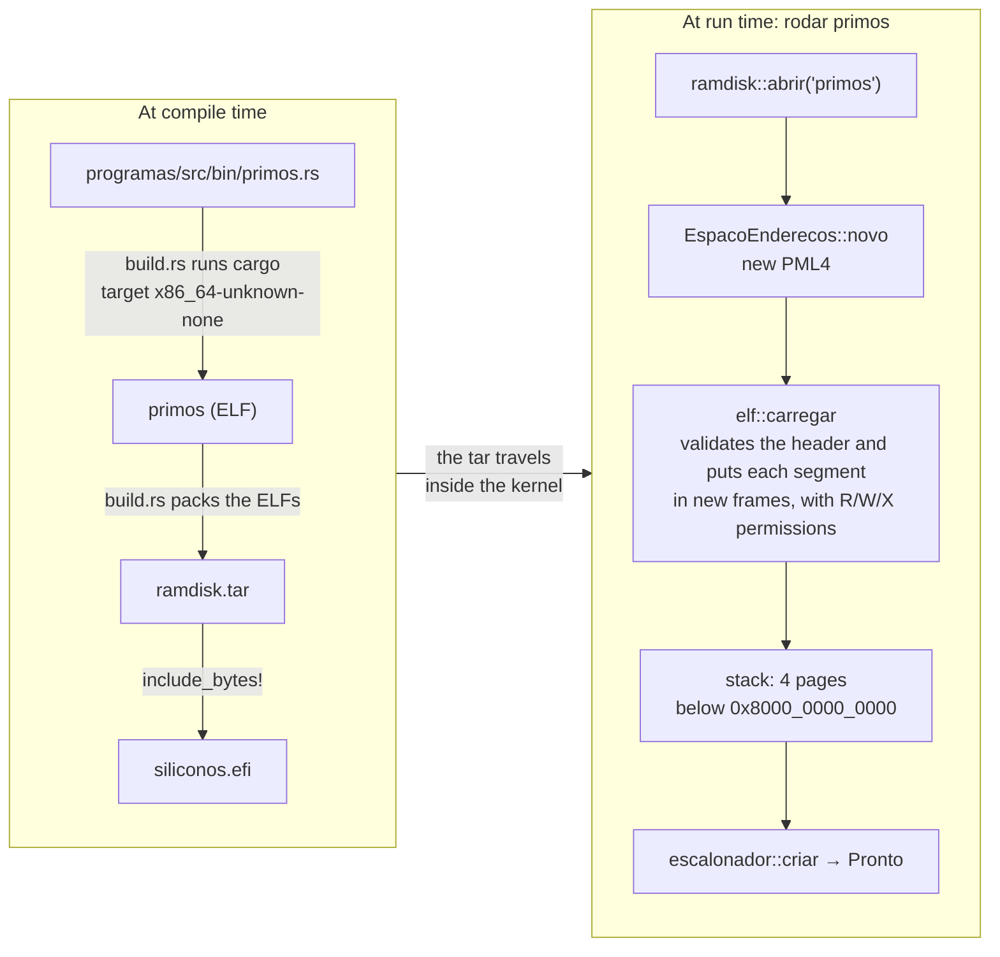

# SiliconOS map

The chapters tell how the system was built **in the order it happened**:
first the serial port, then the GDT, then memory... This page does the
opposite. It shows the system **finished, as it is now**, and answers
questions like:

- What are the pieces (modules), and what is each one's job?
- Who calls whom?
- What happens, step by step, when you press a key? When a program calls
  `println!`? When the timer fires?
- Where does everything live in memory?

Use this page as a map: look at the drawing, find the piece you care about and
follow the link to the chapter that explains it in detail.

> **The other references**
>
> | To find out... | Go to |
> |---|---|
> | what a hardware or OS term means (TSS, PML4, EOI...) | [Glossary](glossario.md) |
> | what a Rust concept means (`Box`, `unsafe`, traits...) | [Rust for people who already program](rust-basico.md) |
> | what a specific function does, in one sentence | [Function index](funcoes.md) |
> | why a piece was built the way it was, with the code explained | its chapter (links below) |

Identifiers in the code are in Portuguese (`escalonador` = scheduler,
`memoria` = memory, `usuario` = user, `quadros` = frames, `teclado` =
keyboard); the tables below translate each module's name.

---

## 1. The layers

An operating system is a middleman: on one side is the **hardware** (CPU,
memory, keyboard, screen, clock); on the other, the **programs**. The kernel
sits in between. Programs never touch the hardware directly; they **ask** the
kernel through *system calls* (syscalls).

The arrows mean "uses". Notice that **only the kernel** has arrows to the
hardware. A program that tries to talk to the hardware on its own (for
example, the `privilegiado` program, which runs `hlt`) gets an exception and
is terminated: the CPU does not let ring 3 do that (doc [10](10-modo-usuario.md)).

---

## 2. The modules, one by one

Each file in `src/` is a **module** (the equivalent of a package or class in
other languages). The "Uses" column lists the modules it calls.

### Output and diagnostics

| Module | Job | Uses | Doc |
|---|---|---|---|
| `main.rs` | Entry point. Talks to UEFI while it still can, takes the screen and the memory map, shuts UEFI down and calls each module's `init` in the right order. Defines `kprintln!`. | all | [00](00-visao-geral.md) |
| `serial.rs` | Writes bytes to the COM1 serial port. It is the output that always works, and it is what the tests read. | none | [01](01-saida-serial-e-video.md) |
| `console.rs` | Draws text on the screen, pixel by pixel, with an 8×8-pixel font scaled up 2 times; scrolls when the screen is full. | none | [01](01-saida-serial-e-video.md) |
| `panic.rs` | What to do when the kernel panics: print the message and stop the machine. | `serial`, `qemu` | [02](02-panic-handler.md) |
| `qemu.rs` | Exits QEMU with a code (used by the tests to say "passed" or "failed"). | `serial` | [09](09-shell-e-testes.md) |
| `testes.rs` (tests) | Runs the `#[test_case]`s when you run `cargo test`. | `qemu` | [09](09-shell-e-testes.md) |

### The CPU

| Module | Job | Uses | Doc |
|---|---|---|---|
| `gdt.rs` | Builds the GDT (the code and data segments of the kernel and of the programs) and the TSS (the stacks the CPU jumps to on an interrupt). | none | [03](03-gdt-e-tss.md), [12](12-escalonador.md) |
| `idt.rs` | Builds the IDT: the table that says which function handles each exception and interrupt. Holds the exception handlers (divide by zero, page fault...). | `gdt`, `interrupcoes`, `usuario` | [04](04-idt-e-excecoes.md) |
| `cpu.rs` | Assorted CPU instructions: `cpuid`, read/write an MSR, and `sem_interrupcoes` ("without interrupts": runs a piece of code with interrupts off). | `gdt`, `serial` | [08](08-interrupcoes-de-hardware.md), [14](14-syscall-sysret.md) |
| `acpi.rs` | Reads the firmware's ACPI tables to find the interrupt controllers, and powers the machine off. | `paginacao`, `timer` | [08](08-interrupcoes-de-hardware.md) |

### Memory (`src/memoria/`)

| Module | Job | Uses | Doc |
|---|---|---|---|
| `mapa.rs` (map) | Turns the UEFI memory map into a list of our own: which ranges of RAM are free. | none | [05](05-memoria-fisica.md) |
| `quadros.rs` (frames) | The **frame** allocator: hands out and takes back 4 KiB physical pages, with a bitmap (one bit per frame). | `cpu` | [05](05-memoria-fisica.md) |
| `paginacao.rs` (paging) | The page tables: map a virtual address to a physical frame, unmap, translate; and `ativar` (activate: load CR3). | `quadros` | [06](06-paginacao.md), [11](11-espacos-de-enderecos.md) |
| `heap.rs` | The heap allocator (`Box`, `Vec`, `String`): a free-block list in a virtual range that grows on demand. | `paginacao`, `cpu` | [07](07-heap.md) |
| `bump.rs` | A simpler allocator (it only moves forward), kept for comparison. | none | [07](07-heap.md) |
| `espaco.rs` (space) | `EspacoEnderecos` (address space): the page tables of **one** program. Copies the kernel's part and owns the program's frames; when destroyed, it gives everything back. | `paginacao`, `quadros` | [11](11-espacos-de-enderecos.md) |

### Interrupts (`src/interrupcoes/`)

| Module | Job | Uses | Doc |
|---|---|---|---|
| `mod.rs` | Wires everything up: reads ACPI, disables the old PIC, configures the APIC and the I/O APIC, installs the handlers and enables interrupts (`sti`). | `acpi`, `idt`, `cpu` | [08](08-interrupcoes-de-hardware.md) |
| `pic.rs` | Disables the 8259 (the old interrupt controller). | `serial` | [08](08-interrupcoes-de-hardware.md) |
| `apic.rs` | The local APIC: each CPU's interrupt controller; includes the EOI ("I'm done handling it"). | `cpu`, `paginacao` | [08](08-interrupcoes-de-hardware.md) |
| `ioapic.rs` | The I/O APIC: routes the devices' interrupts (keyboard...) to the CPU. | `paginacao` | [08](08-interrupcoes-de-hardware.md) |
| `timer.rs` | The clock: 100 ticks per second. On each tick, it tells the scheduler. Also reads the CMOS clock (RTC). | `apic`, `escalonador` | [08](08-interrupcoes-de-hardware.md), [12](12-escalonador.md) |
| `teclado.rs` (keyboard) | Receives the keyboard's *scancodes* into a queue and translates them into characters (US layout). | `apic` | [08](08-interrupcoes-de-hardware.md) |

### Processes and programs

| Module | Job | Uses | Doc |
|---|---|---|---|
| `escalonador.rs` (scheduler) | The process table and the **context switch**: decides who runs, switches the stack, CR3 and TSS.RSP0. Creates, terminates and reaps processes. | `memoria`, `gdt`, `timer`, `usuario` | [12](12-escalonador.md) |
| `usuario/mod.rs` (user) | Prepares a program (space, code, stack) and hands it to the scheduler. Handles the syscalls (`tratar_syscall`) and the programs' faults. | `escalonador`, `memoria`, `timer` | [10](10-modo-usuario.md), [12](12-escalonador.md), [13](13-disco-em-ram-e-elf.md) |
| `usuario/syscall.rs` | The fast door into the kernel: configures the MSRs of the `syscall` instruction and holds the entry `entrada_syscall_rapida`. | `cpu`, `gdt`, `usuario` | [14](14-syscall-sysret.md) |
| `usuario/elf.rs` | Reads ELF files (the executable format) and loads the segments into the program's space. | `memoria`, `usuario` | [13](13-disco-em-ram-e-elf.md) |
| `usuario/programas.rs` (programs) | The old programs, written in assembly and built into the kernel. | none | [10](10-modo-usuario.md) |
| `ramdisk.rs` | The "disk": a tar file with the Rust programs, built into the kernel at compile time. | none | [13](13-disco-em-ram-e-elf.md) |
| `shell.rs` | The command interpreter: reads keys, builds the line and runs the command (`ajuda`, `rodar`, `ps`...). | almost all | [09](09-shell-e-testes.md) |

And outside `src/`:

| Where | Job | Doc |
|---|---|---|
| `build.rs` | Before the kernel is compiled, compiles the programs in `programas/` and packs the executables into a tar file. | [13](13-disco-em-ram-e-elf.md) |
| `programas/` | The user programs in Rust and the `sos` library they use to talk to the kernel. | [13](13-disco-em-ram-e-elf.md), [14](14-syscall-sysret.md) |

---

## 3. Wiring it up: the initialization order

The kernel starts in `main.rs` and brings the pieces up **in a mandatory
order**: each depends on the ones before it. For example, the heap needs
paging (to map its pages), which needs the frame allocator (to have somewhere
to take the tables from), which needs the memory map.

Why are interrupts enabled almost last? Because the timer handler calls the
scheduler, which uses the heap, which uses paging. If the timer fired before
those pieces existed, the kernel would crash.

---

## 4. Where everything lives: the address space

Every address the code uses is **virtual**. The page tables translate each
one to a **physical** address in RAM. The upper half (addresses starting with
`0xFFFF...`) belongs to the kernel and is the same in every process; the lower
half changes from program to program.

The "identity" mapping (virtual = physical) in PML4 entry 0 exists because
UEFI loaded the kernel at a low address and it still runs there. Each program
gets a copy of the present entries of the kernel's PML4 (0, 256, 288 and 320),
but only its own pages have the USER bit: if the program tries to read the
kernel, it gets a page fault (doc [11](11-espacos-de-enderecos.md)).

---

## 5. The path of a key press

You press `a` on the keyboard. Until the letter shows up on the screen:

Two important details:

- **The handler is short.** It only reads the byte and puts it in the queue;
  the shell does the translating, outside the interrupt. A slow handler would
  delay everything else (doc [08](08-interrupcoes-de-hardware.md)).
- **The queue has no lock.** One side only writes (the handler), the other
  only reads (the shell); the indices are atomic. A lock here could hang the
  machine if the interrupt arrived while the lock was held.

---

## 6. The path of a syscall

A Rust program calls `println!("oi")`. The `sos` library turns that into the
`escrever` (write) syscall, number 1:

The old assembly programs take the same path through `int 0x80` (entry
`entrada_syscall`, which ends with `iretq`). Both entries build the **same**
`Registros` struct and call the **same** `tratar_syscall`; only the door is
different. `syscall` is about 3 to 4 times faster (doc [14](14-syscall-sysret.md)).

The syscalls that exist today:

| Number | Name | Arguments | Returns |
|---|---|---|---|
| 0 | `sair` (exit) | exit code | does not return |
| 1 | `escrever` (write) | pointer, length | bytes written (or an error) |
| 2 | `tiques` (ticks) | none | ticks since boot (100 per second) |
| 3 | `pid` | none | the process number |

---

## 7. The timer and the process switch

100 times per second the timer interrupts whoever is running. That is how
several programs seem to run at the same time on a single CPU:

When A's turn comes again, some other process calls `trocar` (switch) towards
A, and A "returns" from `trocar` as if nothing had happened: back to `tique`,
back to the timer handler, and the final `iretq` takes it back to ring 3.

---

## 8. The life of a process

The states are `Pronto` (ready), `Rodando` (running) and `Terminado`
(finished). `criar` (create) is called by `usuario::iniciar` (built-in
programs) or `usuario::iniciar_elf` (programs from the disk). A `Terminado`
process still takes up memory (it is a "zombie") until someone **reaps**
(`recolher`) its result: the shell, when the program runs in the foreground
(`escalonador::esperar`), or the shell loop, for background ones
(`rodar X &`). When it is reaped, the `Drop` of the stack and of the
`EspacoEnderecos` gives the frames back to the allocator.

---

## 9. From source code to a running program

How `programas/src/bin/primos.rs` becomes a process:

---

## 10. Keeping this map up to date

Each new chapter that changes one of these figures updates this page. The
[Function index](funcoes.md) does not need that: it is generated
automatically from the "Functions in this chapter" tables every time the site
is published.
