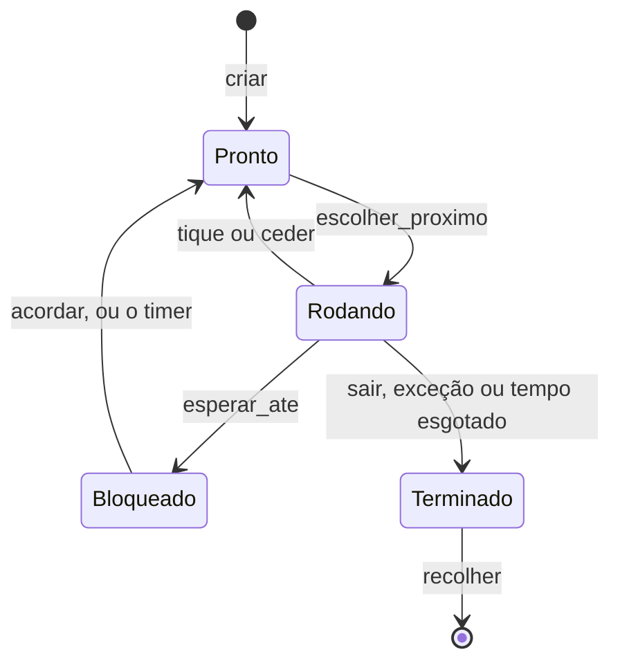

# 15: Dormir e processos bloqueados

> **Você vai entender:** o que é **espera ocupada** e por que ela desperdiça
> a CPU; o estado **Bloqueado**, que tira um processo do rodízio até alguém o
> **acordar**; a syscall **`dormir`**; por que todo sistema precisa de um
> **processo ocioso**; e o bug clássico do **acordar perdido**, que este
> capítulo provoca de propósito para mostrar como ele acontece e como se
> evita.
>
> **Arquivos:** `src/escalonador.rs` (estado `Bloqueado`, `Motivo`, ocioso,
> `esperar_ate`, `acordar`, `dormir`), `src/interrupcoes/teclado.rs` (o
> tratador acorda o shell), `src/shell.rs` (o laço bloqueia; `ps` mostra o
> motivo), `src/usuario/mod.rs` (syscall 4, `dormir`), `programas/src/lib.rs`
> (`sos::dormir`), `programas/src/bin/soneca.rs` e `insone.rs` (novos)
> **Livro:** capítulo 11, seção 11.4 (o livro para na troca preemptiva; os
> estados de bloqueio são nossos)
> **Testar:** `./run.sh`, depois `rodar soneca &`, `ps` e `rodar insone`;
> `./run.sh teste-acordar-perdido`; `cargo test --target x86_64-unknown-uefi`
> **Leia antes:** doc 08 (`hlt` e o `teclado::esperar`), doc 12 (o escalonador)
> **Rust novo aqui:** `impl Fn` (uma closure chamada várias vezes), variantes de
> enum com campos nomeados e aritmética que não estoura
> ([§45](rust-basico.md#45-impl-fn-variantes-com-campos-e-aritmética-sem-estouro))
>
> **Código deste capítulo:** [estado no fim do doc 15](https://github.com/moises-dev-git/siliconOS/tree/doc-15) · [o que mudou desde o doc 14](https://github.com/moises-dev-git/siliconOS/compare/doc-14...doc-15) · mapa em [Mudanças nos arquivos](#mudanças-nos-arquivos)

---

## 1. O problema: esperar gastando a CPU

Até o doc 14, um programa que quisesse esperar meio segundo só tinha um
jeito: perguntar a hora sem parar.

```rust
let fim = sos::tiques() + 50; // 50 tiques = 500 ms
while sos::tiques() < fim {}
```

Isso se chama **espera ocupada** (*busy waiting*). O programa não faz nada
de útil, mas, para o escalonador do doc 12, ele está `Pronto` como qualquer
outro: recebe a sua fatia de CPU a cada rodada e a queima inteira
perguntando "já deu a hora?". Numa máquina com outros processos, ele rouba
tempo deles; numa máquina parada, ele impede a CPU de parar (e um notebook
de economizar bateria).

O kernel tinha o mesmo problema em dois lugares:

- **`escalonador::esperar(pid)`**, que o shell usa para esperar um programa
  de primeiro plano, era um laço de "já terminou? não: `ceder()`". O shell
  continuava no rodízio, acordando a cada tique só para conferir.
- **O laço do shell** dormia com `hlt` (`teclado::esperar`, doc 08) só
  quando não havia mais ninguém pronto; com algum programa rodando, ele
  ficava no rodízio, cedendo a vez a cada tique.

O que falta é um jeito de dizer ao escalonador: **"não me dê a CPU até
acontecer X"**.

---

## 2. A ideia: bloquear e acordar

Todo sistema operacional resolve isso com um estado a mais. Além de
`Pronto`, `Rodando` e `Terminado`, um processo pode estar **Bloqueado**:
esperando alguma coisa, fora do rodízio. Ele só volta a ser `Pronto` quando
alguém o **acorda**: quem fez a coisa acontecer.



Cada bloqueio tem um **motivo**, e cada motivo tem alguém responsável por
acordar:

| Motivo | Quem bloqueia | Quem acorda |
|---|---|---|
| `Dormindo { ate }` | um programa (syscall `dormir`) ou o kernel (`escalonador::dormir`) | o **timer**, quando o tique `ate` chega |
| `Teclado` | o shell, sem tecla para ler | o **tratador do teclado**, quando chega uma tecla (e `encerrar`, quando termina um programa de segundo plano) |
| `Processo(pid)` | quem espera o processo `pid` terminar (`esperar`) | **`encerrar`**, quando `pid` termina |

Na literatura isso aparece com vários nomes: *sleep/wakeup* no Unix
original, *wait queues* no Linux, *condition variables* na programação
concorrente. A ideia é a mesma: quem espera não pergunta; avisam a ele.

### 2.1 Quem roda quando todos estão bloqueados?

Com o shell esperando tecla e os programas dormindo, **ninguém** está pronto.
Mas a CPU não pode "não rodar nada": ela sempre executa alguma instrução. O
escalonador precisa de alguém para quem trocar.

A resposta clássica é o **processo ocioso** (*idle*): um processo do kernel
que nunca bloqueia e só faz `hlt` (doc 08), a instrução que para a CPU até a
próxima interrupção. No Linux ele é o pid 0 (o `swapper`); no Windows, o
"Processo Ocioso do Sistema", que o Gerenciador de Tarefas mostra com o
tempo em que a CPU ficou parada. No SiliconOS, ele é o **pid 1**, e o
comando `ps` também mostra os tiques dele: quanto tempo a CPU ficou parada
desde o boot.

---

## 3. O código: os estados novos

Em `src/escalonador.rs`, o `Estado` ganha uma variante e há um tipo novo para
o motivo:

```rust
pub enum Estado {
    /// Pode rodar; espera a vez.
    Pronto,
    /// É o processo que está na CPU agora.
    Rodando,
    /// Esperando alguma coisa (doc 15). Fora do rodízio até ser acordado.
    Bloqueado(Motivo),
    /// Terminou; espera alguém recolher o resultado e liberar a memória.
    Terminado(Resultado),
}

/// O que um processo bloqueado espera (doc 15).
pub enum Motivo {
    /// Dormindo até o tique `ate` do timer (syscall `dormir`).
    Dormindo { ate: u64 },
    /// Uma tecla (o shell). Também acordado quando termina um processo de
    /// segundo plano, para o shell recolher a memória dele.
    Teclado,
    /// O processo `Pid` terminar (`esperar`).
    Processo(Pid),
}
```

(`Dormindo { ate: u64 }` é uma variante com um campo **nomeado**, como uma
struct; ver [§45](rust-basico.md#45-impl-fn-variantes-com-campos-e-aritmética-sem-estouro).)
As duas enums derivam `PartialEq`, então dá para perguntar
`p.estado == Estado::Bloqueado(Motivo::Teclado)` diretamente.

---

## 4. O processo ocioso

O ocioso é criado em `escalonador::init`, logo depois do processo 0:

```rust
pub fn init() {
    // A pilha do ocioso, fabricada como a dos outros (ver `criar`), mas o
    // `ret` do primeiro `trocar` cai direto em `laco_ocioso`, no anel 0.
    let mut pilha = alloc::vec![0u64; TAM_PILHA_OCIOSO / 8].into_boxed_slice();
    let n = pilha.len();
    pilha[n - 1] = laco_ocioso as *const () as u64;
    let rsp_ocioso = &pilha[n - 7] as *const u64 as u64;
    // ... empurra o processo 0 ("kernel") e o 1 ("ocioso", Pronto) na tabela
}

#[unsafe(naked)]
unsafe extern "sysv64" fn laco_ocioso() -> ! {
    naked_asm!(
        "2:",
        "sti",
        "hlt",
        "jmp 2b",
    )
}
```

É o mesmo truque do doc 12 para um processo novo: uma pilha **fabricada**
como se o processo já tivesse rodado e chamado `trocar`. A diferença é o que
fica embaixo dos 6 registradores. Num programa de usuário, é
`primeira_entrada` mais um quadro de `iretq` para o anel 3. No ocioso, é
direto o endereço de `laco_ocioso`: o `ret` de `trocar` cai lá, no anel 0.

```
  pilha do ocioso (4 KiB)

  topo ─► [ laco_ocioso      ]   endereço de retorno de `trocar`
          [ r15 r14 ... rbx  ]   6 zeros  ◄─ rsp salvo (n - 7)
          [ ...              ]   espaço para as interrupções
```

O laço tem três instruções. `trocar` sempre roda com as interrupções
desligadas (dentro de `ceder`), então o ocioso começa com IF=0: o `sti` liga
de novo, e o `hlt` para a CPU. Quando chega uma interrupção, o tratador roda
**na pilha do ocioso** (ele está no anel 0, então a CPU não troca de pilha);
se o tratador trocar de processo, o ocioso fica parado ali dentro até a
próxima vez. Quando ele voltar, o `iretq` do tratador o devolve para depois
do `hlt`, e o `jmp` recomeça.

Por que `naked`? Porque não há código Rust: nenhuma variável, nenhuma
chamada, e assim não importa se a pilha está alinhada em 16 bytes como a
convenção de chamada exigiria.

### 4.1 Quando escolher o ocioso

`escolher_proximo` (doc 12) faz rodízio entre os prontos. Agora ele pula o
ocioso, e só o escolhe quando não há mais ninguém **e** o atual não pode
continuar:

```rust
fn escolher_proximo() -> Option<(*mut u64, u64)> {
    let mut t = TABELA.lock();
    let n = t.processos.len();
    let atual = t.atual;
    let pronto = (1..n).map(|d| (atual + d) % n)
        .find(|&i| i != OCIOSO && t.processos[i].estado == Estado::Pronto);
    let proximo = match pronto {
        Some(i) => i,
        None if t.processos[atual].estado == Estado::Rodando => return None,
        None => OCIOSO,
    };
    if proximo == atual {
        return None;
    }
    // ... daqui para baixo, igual ao doc 12
```

Os três casos do `match`:

1. Há outro pronto: troca para ele (o rodízio de sempre).
2. Ninguém mais pronto, mas o atual ainda está `Rodando`: continua com ele
   (`None` = "não troque").
3. Ninguém pronto e o atual **não** pode continuar (acabou de bloquear ou de
   terminar): vai para o ocioso.

`if proximo == atual` cobre o ocioso no caso 3: se é ele quem está rodando,
não há para onde trocar.

### 4.2 E se não houvesse ocioso?

Para ver que ele é necessário, troquei temporariamente `None => OCIOSO` por
`None => return None`. A máquina liga, imprime `silicon> ` e **trava**: a
tecla `a` enviada pelo monitor do QEMU nunca aparece. O `info registers` do
monitor mostra por quê:

```
RIP=0000000005febffe RFL=00000097 [--S-APC] CPL=0 II=0 A20=1 SMM=0 HLT=0
```

RFLAGS = 0x97: o bit IF (0x200) está **desligado**, e `HLT=0`: a CPU não
está parada, está girando. O shell bloqueou, `escolher_proximo` disse "não
troque", e `esperar_ate` (seção 5) voltou a conferir a condição, de novo e
de novo, com as interrupções desligadas. A tecla nunca é entregue, e a
condição nunca fica verdadeira. Com o ocioso, há sempre alguém para quem
trocar, e é ele quem religa as interrupções.

---

## 5. Bloquear sem perder o aviso: `esperar_ate`

Toda espera tem a mesma forma: "enquanto a condição não for verdadeira,
durma". O jeito ingênuo de escrever isso tem um defeito que vale a pena
entender, porque ele aparece em todo código concorrente:

```
  shell                                    tratador do teclado
  ─────                                    ───────────────────
  a fila está vazia? sim
                       ◄── tecla chega ──  põe na fila
                                           acorda quem espera tecla:
                                           ninguém (o shell ainda
                                           não está bloqueado)
  bloqueia: Bloqueado(Teclado)
  ... dorme, com uma tecla na fila
```

Isso é o **acordar perdido** (*lost wakeup*): o aviso chegou **entre** o
"conferi" e o "fui dormir", e se perdeu. O shell fica bloqueado esperando
algo que já aconteceu, até que outra tecla o acorde.

A correção é não deixar o tratador rodar nesse intervalo: conferir a
condição e marcar o processo como bloqueado **com as interrupções
desligadas**, de uma vez só:

```rust
pub fn esperar_ate(motivo: Motivo, condicao: impl Fn() -> bool) {
    cpu::sem_interrupcoes(|| {
        while !condicao() {
            bloquear_e_trocar(motivo);
        }
    });
}

fn bloquear_e_trocar(motivo: Motivo) {
    {
        let mut t = TABELA.lock();
        let a = t.atual;
        assert!(a != OCIOSO, "o ocioso nunca bloqueia");
        t.processos[a].estado = Estado::Bloqueado(motivo);
    }
    if let Some((salvar, novo_rsp)) = escolher_proximo() {
        unsafe { trocar(salvar, novo_rsp) };
    }
}
```

Passo a passo:

1. Com as interrupções desligadas, confere a condição. Se já é verdadeira,
   sai sem bloquear.
2. Senão, marca o atual como `Bloqueado(motivo)` e troca de processo. As
   interrupções continuam desligadas até o `trocar`: nenhum tratador roda
   entre o passo 1 e este. Se a tecla chegar agora, ela fica **pendente** no
   APIC e só é entregue depois da troca, quando o tratador já vai achar o
   shell bloqueado e acordá-lo.
3. Quando alguém acorda o processo e chega a vez dele, `trocar` "retorna"
   e o `while` confere a condição **de novo**. Isso importa: ser acordado
   quer dizer "talvez tenha mudado", não "mudou". Por exemplo, o shell é
   acordado também quando termina um programa de segundo plano, sem tecla
   nenhuma.

A condição é uma closure, `impl Fn() -> bool`: `Fn`, e não `FnOnce` como em
`sem_interrupcoes` (doc 08), porque ela é chamada várias vezes
([§45](rust-basico.md#45-impl-fn-variantes-com-campos-e-aritmética-sem-estouro)).

Este é o mesmo problema que o doc 08 já tinha resolvido, em ponto pequeno,
em `teclado::esperar`: `cli`, conferir a fila, e `sti; hlt` juntos, porque
a CPU só aceita interrupções depois da instrução que segue o `sti`. Ali a
"troca" era o `hlt`; aqui é o `trocar`. A regra é a mesma: **a conferência
e o "ir dormir" precisam ser uma coisa só, sem intervalo para o aviso**.

### 5.1 Acordar

```rust
pub fn acordar(motivo: Motivo) -> usize {
    cpu::sem_interrupcoes(|| acordar_em(&mut TABELA.lock(), motivo))
}

fn acordar_em(t: &mut Tabela, motivo: Motivo) -> usize {
    let mut n = 0;
    for p in t.processos.iter_mut().filter(|p| p.estado == Estado::Bloqueado(motivo)) {
        p.estado = Estado::Pronto;
        n += 1;
    }
    n
}
```

Acordar só muda o estado para `Pronto`; quem roda é decidido pelo
escalonador, como sempre. `acordar` pode ser chamada de dentro de um
tratador de interrupção, e isso é seguro pela regra do doc 12: **todo lock
do kernel é pego com as interrupções desligadas**. Numa CPU só, isso quer
dizer que, se um tratador está rodando, ninguém está com o lock da tabela na
mão. (`acordar_em` existe para `encerrar`, que já está com o lock e não pode
pegá-lo de novo.)

### 5.2 O bug de propósito: `teste-acordar-perdido`

Para ver o acordar perdido acontecer, a feature `teste-acordar-perdido` põe,
dentro do `while` de `esperar_ate`, entre conferir e bloquear, uma janela de
3 segundos com as interrupções ligadas:

```rust
#[cfg(feature = "teste-acordar-perdido")]
fn janela_do_acordar_perdido() {
    let fim = timer::tiques() + 3 * timer::FREQUENCIA_HZ;
    crate::kprint!("[janela aberta no tique {}]", timer::tiques());
    while timer::tiques() < fim {
        cpu::ligar_interrupcoes();
        unsafe { core::arch::asm!("hlt") };
        cpu::desligar_interrupcoes();
    }
    crate::kprint!("[janela fechada no tique {}: bloqueando]", timer::tiques());
}
```

Com `./run.sh teste-acordar-perdido`, apertei `a` um segundo depois de a
janela abrir e esperei 4 segundos. A serial mostrava só isto:

```
silicon> [janela aberta no tique 3][janela fechada no tique 303: bloqueando]
```

O `a` não apareceu, embora estivesse na fila desde o tique ~100. Ao apertar
`b`:

```
silicon> [janela aberta no tique 3][janela fechada no tique 303: bloqueando]ab[janela aberta no tique 507]
```

O `b` acordou o shell, e as duas letras saíram juntas. Sem a feature, o
mesmo roteiro mostra o `a` na hora. Num sistema de verdade a janela tem
alguns nanossegundos, e não 3 segundos: o bug acontece uma vez em mil, e
ninguém consegue reproduzi-lo. Por isso se fecha a janela por construção.

---

## 6. Os três que esperam

### 6.1 O shell espera tecla

O laço do shell (`src/shell.rs`) deixa de olhar se há outros prontos e
simplesmente bloqueia:

```rust
loop {
    while let Some(scancode) = teclado::proximo_scancode() {
        // ... traduz e trata a tecla, como no doc 09
    }
    escalonador::recolher_segundo_plano();
    escalonador::esperar_ate(Motivo::Teclado, || {
        teclado::tem_scancode() || escalonador::ha_terminados_em_segundo_plano()
    });
}
```

A condição tem duas partes porque o shell tem duas tarefas: ler teclas e
recolher a memória dos programas de segundo plano que terminaram (doc 12).
`teclado::tem_scancode` substitui o `teclado::esperar` do doc 08.

O tratador do teclado, depois de pôr o byte na fila e mandar o EOI, acorda
quem espera tecla:

```rust
    apic::eoi();

    // Acordar quem espera tecla (o shell, doc 15) e já dar a vez a ele:
    // sem isso, a tecla só apareceria no próximo tique (até 10 ms depois).
    if escalonador::acordar(Motivo::Teclado) > 0 {
        escalonador::ceder();
    }
```

O `ceder` é o mesmo que o timer faz (doc 12), e pelo mesmo motivo vem
depois do EOI. Sem ele, o shell ficaria `Pronto`, mas a CPU continuaria com
quem estava rodando (quase sempre o ocioso, parado no `hlt`) até o próximo
tique. Medi isso com uma instrumentação temporária (o contador de ciclos
`rdtsc` lido no tratador e de novo quando o shell pega a tecla), com KVM, em
que o contador anda a 2,6 GHz:

| | ciclos entre a interrupção e o shell |
|---|---|
| com o `ceder` | 98 a 183 mil (menos de 0,1 ms) |
| sem o `ceder` | 0,17 a 23,8 milhões (até ~9 ms: o que faltava para o próximo tique) |

### 6.2 `esperar` espera um processo

```rust
pub fn esperar(pid: Pid) -> Resultado {
    esperar_ate(Motivo::Processo(pid), || terminou(pid));
    recolher(pid).unwrap_or_else(|| panic!("esperar: o processo {} nao existe", pid))
}
```

E `encerrar`, ao marcar um processo como `Terminado`, acorda quem o
esperava (e o shell, se era de segundo plano):

```rust
        p.estado = Estado::Terminado(resultado);
        let (pid, nome, segundo_plano) = (p.pid, p.nome, p.segundo_plano);
        acordar_em(&mut t, Motivo::Processo(pid));
        if segundo_plano {
            acordar_em(&mut t, Motivo::Teclado);
        }
```

### 6.3 Um programa dorme: a syscall `dormir`

O timer já passa por `escalonador::tique` 100 vezes por segundo; agora ele
também acorda quem dormia até o tique atual (e conta os tiques do ocioso):

```rust
pub fn tique(quadro: &QuadroInterrupcao) {
    let agora = timer::tiques();
    cpu::sem_interrupcoes(|| {
        let mut t = TABELA.lock();
        for p in t.processos.iter_mut() {
            if let Estado::Bloqueado(Motivo::Dormindo { ate }) = p.estado {
                if agora >= ate {
                    p.estado = Estado::Pronto;
                }
            }
        }
        if t.atual == OCIOSO {
            t.processos[OCIOSO].tiques_cpu += 1;
        }
    });
    // ... o resto, igual ao doc 12 (tempo de CPU, limite, ceder)
```

Dormir é só bloquear com a condição "o tique `ate` chegou":

```rust
pub fn dormir(tiques: u64) {
    let ate = timer::tiques() + tiques;
    esperar_ate(Motivo::Dormindo { ate }, || timer::tiques() >= ate);
}
```

A syscall número 4 recebe milissegundos e os arredonda **para cima** em
tiques, para que pedir 1 ms durma um tique, e não zero:

```rust
fn dormir(ms: u64) -> u64 {
    escalonador::dormir(ms_para_tiques(ms));
    0
}

fn ms_para_tiques(ms: u64) -> u64 {
    ms.saturating_mul(timer::FREQUENCIA_HZ).div_ceil(1000)
}
```

(`saturating_mul` não estoura com um `ms` absurdo vindo do programa; ver
[§45](rust-basico.md#45-impl-fn-variantes-com-campos-e-aritmética-sem-estouro).)

Dormir **dentro de uma syscall** funciona sem nada especial: a chamada
chega pela pilha do kernel do processo (doc 12 e doc 14), e `trocar` guarda
essa pilha como guarda qualquer outra. Quando o processo acordar, ele volta
de `trocar`, de `esperar_ate`, de `tratar_syscall` e, por fim, do `sysretq`,
como se a syscall tivesse só demorado.

Na biblioteca `sos`:

```rust
const SYS_DORMIR: u64 = 4;

pub fn dormir(ms: u64) {
    chamada(SYS_DORMIR, ms, 0);
}
```

### 6.4 Dois programas para comparar

`programas/src/bin/soneca.rs` acorda 5 vezes, uma a cada meio segundo,
dormindo no intervalo:

```rust
fn main() -> u64 {
    let pid = sos::pid();
    for vez in 1..=5 {
        println!("soneca (pid {}): acordei, vez {} (tique {})", pid, vez, sos::tiques());
        sos::dormir(500);
    }
    0
}
```

`programas/src/bin/insone.rs` faz o mesmo, mas espera do jeito antigo, com
a espera ocupada da seção 1.

---

## 7. Como foi testado

### 7.1 Pelo shell

O `ps` mostra o ocioso e o motivo de cada bloqueio. Com `rodar soneca &`
seguido de `ps` (as linhas do `soneca` se misturam com o que eu digitava,
porque ele imprime em segundo plano):

```
silicon> rodar soneca &
[2] 'soneca' em segundo plano
soneca (pid 2): acordei, vez 1 (tique 559)
soneca (pid 2): acordei, vez 2 (tique 611)
soneca (pid 2): acordei, vez 3 (tique 662)
ps
  PID  ESTADO               CPU (tiques)  NOME
    0  rodando                         0  kernel
    1  pronto                        651  ocioso
    2  dormindo ate 714                4  soneca
silicon> soneca (pid 2): acordei, vez 4 (tique 714)
soneca (pid 2): acordei, vez 5 (tique 766)

[2] 'soneca' terminou: codigo de saida 0
```

O ocioso já tinha 651 tiques: desde o boot, a CPU ficou parada quase o tempo
todo. O `soneca` usou **4** tiques de CPU nos ~130 tiques (1,3 s) que tinha
de vida. Ele acorda
a cada 51 ou 52 tiques, e não 50, porque o intervalo é "imprimir a linha +
dormir 50 tiques", e no QEMU sem KVM imprimir é lento: com KVM, os
intervalos medidos foram exatamente 50, 50, 50 e 50.

O `insone`, do jeito antigo:

```
silicon> rodar insone
insone (pid 3): acordei, vez 1 (tique 1604)
insone (pid 3): acordei, vez 2 (tique 1656)
insone (pid 3): acordei, vez 3 (tique 1706)
insone (pid 3): acordei, vez 4 (tique 1756)
'insone' encerrado pelo kernel: usou 2 s de CPU sem terminar
```

Ele nem chega à quinta vez: em 2 segundos, gastou os 200 tiques de CPU que o
kernel permite (o `LIMITE_TIQUES` do doc 12), e foi encerrado como se
estivesse num laço infinito. Do ponto de vista do kernel, **estava**: a
espera ocupada e o laço infinito são indistinguíveis.

### 7.2 Quanto a CPU de verdade trabalha

O QEMU é um programa do Linux, e o tempo de CPU dele aparece em
`/proc/<pid>/task/*/stat`. Medi a thread que executa a CPU virtual, em
janelas de 1,5 s (duas rodadas de cada, com o mesmo resultado):

| Situação | TCG (sem KVM) | KVM |
|---|---|---|
| shell esperando tecla, nada mais | 1% | 1% |
| `soneca` rodando | 5% | 2% |
| `insone` rodando | **100%** | **100%** |

O `soneca` e o `insone` fazem a mesma coisa vista de fora. Um deles mantém
um núcleo da máquina real ocupado o tempo todo.

### 7.3 `cargo test`

Cinco testes novos, 53 no total, todos passando:

```
siliconos::escalonador::testes::insone_gasta_a_cpu_e_e_encerrado ... insone (pid 6): acordei, vez 1 (tique 662)
insone (pid 6): acordei, vez 2 (tique 713)
insone (pid 6): acordei, vez 3 (tique 763)
insone (pid 6): acordei, vez 4 (tique 813)
(0 tiques com a CPU parada) [ok]
siliconos::escalonador::testes::o_kernel_dorme_e_a_cpu_fica_parada ... (20 tiques, 20 com a CPU parada) [ok]
siliconos::escalonador::testes::o_kernel_e_o_processo_zero ... [ok]
siliconos::escalonador::testes::o_ocioso_e_o_processo_um ... [ok]
...
siliconos::escalonador::testes::soneca_dorme_sem_gastar_cpu ... soneca (pid 8): acordei, vez 1 (tique 893)
...
(258 tiques, 250 com a CPU parada) [ok]
...
siliconos::usuario::testes::milissegundos_viram_tiques_para_cima ... [ok]
Todos os 53 testes passaram.
```

`o_kernel_dorme_e_a_cpu_fica_parada` é o processo 0 (quem roda os testes)
chamando `escalonador::dormir(20)`: durante os 20 tiques, quem rodou foi o
ocioso. Nos testes do `soneca` e do `insone`, o kernel espera o programa com
`esperar`, bloqueado; então os tiques do ocioso medem quanto a CPU ficou
parada **enquanto o programa existia**: 250 de 258 com o `soneca`, 0 com o
`insone`.

Os testes do doc 12 (`dois_contadores_ao_mesmo_tempo`, 252 tiques;
`dois_lacos_dividem_a_cpu`, 400 tiques) continuam passando com os mesmos
números: o bloqueio não mudou o rodízio entre os prontos.

### 7.4 Regressão

As 24 builds (a normal e as 23 features de teste e diagnóstico dos
capítulos anteriores) se comportam como antes: cada exceção
provocada aparece com a mesma mensagem, os testes de memória, heap e timer
imprimem "OK", e `teste-deadlock` trava de propósito.

---

## O que ainda falta

- **Os programas não leem o teclado.** Só o shell espera tecla. Uma syscall
  `ler` que bloqueasse com `Motivo::Teclado` seria pequena; o problema é
  decidir **quem** recebe a tecla quando dois programas esperam, o que leva à
  ideia de terminal e de processo "em primeiro plano".
- **`acordar` percorre a tabela inteira.** Com 5 processos, tanto faz; com
  milhares, o Linux usa uma fila por motivo (*wait queue*), e o timer guarda
  os que dormem ordenados pelo prazo.
- **O timer acorda a CPU 100 vezes por segundo**, mesmo com tudo parado.
  Sistemas modernos programam o próximo tique para o próximo prazo
  (*tickless*), e o ocioso dorme de verdade por mais tempo.
- **Uma CPU só.** Com várias, desligar as interrupções não basta para fechar
  a janela do acordar perdido: outra CPU pode estar mexendo na tabela ao mesmo
  tempo. Aí entram os spinlocks de verdade (e o `swapgs`).

---

## Mudanças nos arquivos

O que este capítulo acrescenta ao código do doc 14 (tag `doc-14`). O link de
cada arquivo leva ao estado dele no fim deste capítulo (tag `doc-15`); todas as
linhas que mudaram estão na [comparação entre as duas tags](https://github.com/moises-dev-git/siliconOS/compare/doc-14...doc-15).

| Arquivo | O que muda | Onde |
|---|---|---|
| [`src/escalonador.rs`](https://github.com/moises-dev-git/siliconOS/blob/doc-15/src/escalonador.rs) | `Estado::Bloqueado`, `Motivo`, `OCIOSO`; `init` cria o ocioso; `laco_ocioso`; `escolher_proximo` pula o ocioso (seção 4.1); `tique` acorda quem dorme; `encerrar` acorda quem espera; `esperar` bloqueia; `esperar_ate`, `bloquear_e_trocar`, `acordar`, `acordar_em`, `dormir`, `terminou`, `ha_terminados_em_segundo_plano`, `janela_do_acordar_perdido`; sai `ha_outros_prontos`; 4 testes | — |
| [`src/interrupcoes/teclado.rs`](https://github.com/moises-dev-git/siliconOS/blob/doc-15/src/interrupcoes/teclado.rs) | o tratador acorda e cede (seção 6.1); `tem_scancode` no lugar de `fila_vazia` e `esperar` | fim de `tratador`; onde ficava `esperar` |
| [`src/shell.rs`](https://github.com/moises-dev-git/siliconOS/blob/doc-15/src/shell.rs) | o laço de `rodar` bloqueia (seção 6.1); `ps` mostra o motivo | `rodar`; `ps` |
| [`src/usuario/mod.rs`](https://github.com/moises-dev-git/siliconOS/blob/doc-15/src/usuario/mod.rs) | `SYS_DORMIR`, `dormir`, `ms_para_tiques`; 1 teste | constantes; `tratar_syscall`; antes de `escrever` |
| [`programas/src/lib.rs`](https://github.com/moises-dev-git/siliconOS/blob/doc-15/programas/src/lib.rs) | `SYS_DORMIR` e `dormir` | constantes; antes de `Console` |
| [`programas/src/bin/soneca.rs`](https://github.com/moises-dev-git/siliconOS/blob/doc-15/programas/src/bin/soneca.rs), [`insone.rs`](https://github.com/moises-dev-git/siliconOS/blob/doc-15/programas/src/bin/insone.rs) | **novos** (seção 6.4) | — |
| [`src/ramdisk.rs`](https://github.com/moises-dev-git/siliconOS/blob/doc-15/src/ramdisk.rs) | testes: 6 nomes; a contagem do tar estragado compara com `arquivos().count()` | testes |
| [`Cargo.toml`](https://github.com/moises-dev-git/siliconOS/blob/doc-15/Cargo.toml) | feature `teste-acordar-perdido` | `[features]`, no fim |

### Os trechos que o texto não mostrou

O `use` novo de `escalonador.rs`, a constante do ocioso e a contagem de
tiques no `Processo`:

```rust
use crate::interrupcoes::timer;

/// Índice e pid do processo ocioso: sempre o segundo da tabela.
const OCIOSO: usize = 1;

    /// Tiques do timer que pegaram este processo no anel 3 (no ocioso:
    /// os tiques em que a CPU estava parada, desde o doc 15).
    pub tiques_cpu: u64,
```

O fim de `init` e a constante da pilha:

```rust
        t.processos.push(Box::new(Processo {
            pid: 1, nome: "ocioso", estado: Estado::Pronto, rsp: rsp_ocioso,
            pilha: Some(pilha), espaco: None, tiques_cpu: 0, segundo_plano: false,
        }));
        t.proximo_pid = 2;
    });
}

/// Pilha do ocioso: só recebe os quadros das interrupções que o acordam.
const TAM_PILHA_OCIOSO: usize = 4 * 1024;
```

`esperar_ate` com a chamada da feature, e os dois ajudantes:

```rust
pub fn esperar_ate(motivo: Motivo, condicao: impl Fn() -> bool) {
    cpu::sem_interrupcoes(|| {
        while !condicao() {
            #[cfg(feature = "teste-acordar-perdido")]
            janela_do_acordar_perdido();
            bloquear_e_trocar(motivo);
        }
    });
}

fn terminou(pid: Pid) -> bool {
    cpu::sem_interrupcoes(|| {
        let t = TABELA.lock();
        t.processos.iter().find(|p| p.pid == pid).is_none_or(|p| matches!(p.estado, Estado::Terminado(_)))
    })
}

pub fn ha_terminados_em_segundo_plano() -> bool {
    cpu::sem_interrupcoes(|| {
        let t = TABELA.lock();
        t.processos.iter().any(|p| p.segundo_plano && matches!(p.estado, Estado::Terminado(_)))
    })
}
```

Em `teclado.rs`:

```rust
use crate::escalonador::{self, Motivo};

pub fn tem_scancode() -> bool {
    LEITURA.load(Ordering::Relaxed) != ESCRITA.load(Ordering::Acquire)
}
```

Em `shell.rs`, o `use` passa a ser `use crate::escalonador::{self, Motivo};`, e o `ps`:

```rust
fn ps(_: &[&str]) {
    use crate::escalonador::Estado;
    use alloc::format;
    kprintln!("  PID  ESTADO               CPU (tiques)  NOME");
    for (pid, nome, estado, tiques) in escalonador::listar() {
        let estado = match estado {
            Estado::Pronto => format!("pronto"),
            Estado::Rodando => format!("rodando"),
            Estado::Bloqueado(Motivo::Dormindo { ate }) => format!("dormindo ate {}", ate),
            Estado::Bloqueado(Motivo::Teclado) => format!("esperando tecla"),
            Estado::Bloqueado(Motivo::Processo(p)) => format!("esperando pid {}", p),
            Estado::Terminado(_) => format!("terminado"),
        };
        kprintln!("  {:>3}  {:<19}  {:>12}  {}", pid, estado, tiques, nome);
    }
}
```

Em `usuario/mod.rs`, `pub const SYS_DORMIR: u64 = 4;` depois de `SYS_PID`, e
no `match` de `tratar_syscall`, `SYS_DORMIR => dormir(r.rdi),`. O teste:

```rust
    #[test_case]
    fn milissegundos_viram_tiques_para_cima() {
        assert_eq!(ms_para_tiques(0), 0);
        assert_eq!(ms_para_tiques(1), 1);
        assert_eq!(ms_para_tiques(10), 1);
        assert_eq!(ms_para_tiques(11), 2);
        assert_eq!(ms_para_tiques(500), 50);
        assert_eq!(ms_para_tiques(u64::MAX), u64::MAX.div_ceil(1000));
    }
```

Os testes novos de `escalonador.rs` (antes de `processo_terminado_devolve_pilha_e_quadros`):

```rust
    /// Tiques de CPU parada (os do ocioso) até agora.
    fn tiques_ociosos() -> u64 {
        listar()[OCIOSO].3
    }

    fn rodar_do_disco(nome: &str) -> Resultado {
        let arquivo = crate::ramdisk::abrir(nome).unwrap();
        esperar(usuario::iniciar_elf(arquivo.nome, arquivo.dados, false).unwrap())
    }

    #[test_case]
    fn o_ocioso_e_o_processo_um() {
        let lista = listar();
        assert_eq!((lista[OCIOSO].0, lista[OCIOSO].1), (1, "ocioso"));
        assert_eq!(lista[OCIOSO].2, Estado::Pronto);
    }

    #[test_case]
    fn o_kernel_dorme_e_a_cpu_fica_parada() {
        let (inicio, ocioso) = (timer::tiques(), tiques_ociosos());
        dormir(20);
        let (passou, parada) = (timer::tiques() - inicio, tiques_ociosos() - ocioso);
        crate::kprint!("({} tiques, {} com a CPU parada) ", passou, parada);
        assert!((20..=21).contains(&passou), "dormiu {} tiques", passou);
        assert!(parada >= 19, "so {} tiques ociosos", parada);
    }

    #[test_case]
    fn soneca_dorme_sem_gastar_cpu() {
        let (inicio, ocioso) = (timer::tiques(), tiques_ociosos());
        assert_eq!(rodar_do_disco("soneca"), Resultado::Saiu(0));
        let (passou, parada) = (timer::tiques() - inicio, tiques_ociosos() - ocioso);
        crate::kprint!("({} tiques, {} com a CPU parada) ", passou, parada);
        assert!(passou >= 200, "levou so {} tiques", passou);
        assert!(parada * 10 >= passou * 9, "so {} de {} tiques ociosos", parada, passou);
    }

    #[test_case]
    fn insone_gasta_a_cpu_e_e_encerrado() {
        let ocioso = tiques_ociosos();
        assert_eq!(rodar_do_disco("insone"), Resultado::TempoEsgotado);
        let parada = tiques_ociosos() - ocioso;
        crate::kprint!("({} tiques com a CPU parada) ", parada);
        assert!(parada < 10, "{} tiques ociosos", parada);
    }
```

---

## Funções deste capítulo

Todas as funções que este capítulo acrescenta, em uma frase cada. As mais importantes foram explicadas no texto acima; esta tabela serve de mapa e de referência rápida. (Funções que já existiam e só mudaram aparecem em [Mudanças nos arquivos](#mudanças-nos-arquivos).)

| Função | Arquivo | O que faz |
|---|---|---|
| `laco_ocioso` | [escalonador.rs](https://github.com/moises-dev-git/siliconOS/blob/doc-15/src/escalonador.rs) | (naked) O processo ocioso: `sti; hlt` para sempre; roda quando ninguém mais pode rodar. |
| `esperar_ate` | [escalonador.rs](https://github.com/moises-dev-git/siliconOS/blob/doc-15/src/escalonador.rs) | Bloqueia o processo atual até a condição ser verdadeira, conferindo-a com as interrupções desligadas (sem acordar perdido). |
| `bloquear_e_trocar` | [escalonador.rs](https://github.com/moises-dev-git/siliconOS/blob/doc-15/src/escalonador.rs) | Marca o atual como `Bloqueado(motivo)` e troca de processo; volta quando o acordarem e chegar a vez dele. |
| `janela_do_acordar_perdido` | [escalonador.rs](https://github.com/moises-dev-git/siliconOS/blob/doc-15/src/escalonador.rs) | (só com `teste-acordar-perdido`) Liga as interrupções por 3 s entre conferir e bloquear, para mostrar o bug. |
| `acordar` | [escalonador.rs](https://github.com/moises-dev-git/siliconOS/blob/doc-15/src/escalonador.rs) | Põe como `Pronto` todo processo bloqueado pelo motivo dado e devolve quantos; pode ser chamada de um tratador. |
| `acordar_em` | [escalonador.rs](https://github.com/moises-dev-git/siliconOS/blob/doc-15/src/escalonador.rs) | O mesmo que `acordar`, para quem já está com o lock da tabela (`encerrar`). |
| `dormir` | [escalonador.rs](https://github.com/moises-dev-git/siliconOS/blob/doc-15/src/escalonador.rs) | Bloqueia o processo atual por pelo menos tantos tiques, sem gastar CPU. |
| `terminou` | [escalonador.rs](https://github.com/moises-dev-git/siliconOS/blob/doc-15/src/escalonador.rs) | O processo `pid` terminou (ou nem existe)? A condição de `esperar`. |
| `ha_terminados_em_segundo_plano` | [escalonador.rs](https://github.com/moises-dev-git/siliconOS/blob/doc-15/src/escalonador.rs) | Há processo de segundo plano terminado esperando ser recolhido? (parte da condição do shell) |
| `tem_scancode` | [interrupcoes/teclado.rs](https://github.com/moises-dev-git/siliconOS/blob/doc-15/src/interrupcoes/teclado.rs) | Há scancode na fila? Substitui `esperar` e `fila_vazia`. |
| `dormir` (syscall) | [usuario/mod.rs](https://github.com/moises-dev-git/siliconOS/blob/doc-15/src/usuario/mod.rs) | Syscall 4: dorme `ms` milissegundos (arredondados para cima em tiques); devolve 0. |
| `ms_para_tiques` | [usuario/mod.rs](https://github.com/moises-dev-git/siliconOS/blob/doc-15/src/usuario/mod.rs) | Milissegundos em tiques, arredondando para cima e sem estourar. |
| `dormir` (sos) | [programas/src/lib.rs](https://github.com/moises-dev-git/siliconOS/blob/doc-15/programas/src/lib.rs) | Chama a syscall `dormir`. |
| `main` (soneca) | [programas/src/bin/soneca.rs](https://github.com/moises-dev-git/siliconOS/blob/doc-15/programas/src/bin/soneca.rs) | Acorda 5 vezes, a cada 500 ms, dormindo no intervalo. |
| `main` (insone) | [programas/src/bin/insone.rs](https://github.com/moises-dev-git/siliconOS/blob/doc-15/programas/src/bin/insone.rs) | O mesmo que `soneca`, mas com espera ocupada. |

Testes automáticos (`#[test_case]`, rodam com `cargo test`, ver doc 09):

| Função | Arquivo | O que faz |
|---|---|---|
| `tiques_ociosos` | [escalonador.rs](https://github.com/moises-dev-git/siliconOS/blob/doc-15/src/escalonador.rs) | Ajudante: os tiques do ocioso até agora (tempo de CPU parada). |
| `rodar_do_disco` | [escalonador.rs](https://github.com/moises-dev-git/siliconOS/blob/doc-15/src/escalonador.rs) | Ajudante: roda um programa do disco em RAM e espera o resultado. |
| `o_ocioso_e_o_processo_um` | [escalonador.rs](https://github.com/moises-dev-git/siliconOS/blob/doc-15/src/escalonador.rs) | Teste: o processo 1 é o "ocioso" e está `Pronto`. |
| `o_kernel_dorme_e_a_cpu_fica_parada` | [escalonador.rs](https://github.com/moises-dev-git/siliconOS/blob/doc-15/src/escalonador.rs) | Teste: `dormir(20)` leva 20 ou 21 tiques, quase todos com o ocioso rodando. |
| `soneca_dorme_sem_gastar_cpu` | [escalonador.rs](https://github.com/moises-dev-git/siliconOS/blob/doc-15/src/escalonador.rs) | Teste: enquanto o `soneca` existe, a CPU fica parada pelo menos 90% do tempo. |
| `insone_gasta_a_cpu_e_e_encerrado` | [escalonador.rs](https://github.com/moises-dev-git/siliconOS/blob/doc-15/src/escalonador.rs) | Teste: o `insone` não deixa a CPU parar e é encerrado por tempo esgotado. |
| `milissegundos_viram_tiques_para_cima` | [usuario/mod.rs](https://github.com/moises-dev-git/siliconOS/blob/doc-15/src/usuario/mod.rs) | Teste: 1 ms vira 1 tique, 11 ms viram 2, `u64::MAX` não estoura. |

---

## Diferença em relação ao livro

O livro termina na troca preemptiva de processos; bloqueio, processo ocioso
e a syscall `dormir` são nossos. As escolhas: um estado `Bloqueado` com um
motivo (em vez de filas de espera separadas), o ocioso como um processo
comum da tabela (pid 1) e a condição conferida com as interrupções
desligadas, que só basta porque há uma CPU.

## Resumo

- **Espera ocupada** (perguntar sem parar) gasta a CPU inteira: o `insone`
  mantém um núcleo da máquina real em 100% e é encerrado pelo limite de
  tempo de CPU. O `soneca`, que dorme, deixa a CPU parada em 250 de 258
  tiques.
- Um processo **Bloqueado** está fora do rodízio até ser **acordado** por
  quem resolve o motivo: o timer (`Dormindo`), o tratador do teclado
  (`Teclado`) ou `encerrar` (`Processo`).
- O **processo ocioso** (pid 1) roda quando ninguém mais pode: `sti; hlt`.
  Sem ele, o kernel ficaria girando com as interrupções desligadas, e a
  máquina travaria (testado).
- `esperar_ate` confere a condição e bloqueia **com as interrupções
  desligadas**, e confere de novo ao acordar. Isso fecha a janela do
  **acordar perdido**, que `teste-acordar-perdido` abre de propósito: a
  tecla fica na fila até outra tecla chegar.
- O tratador do teclado acorda o shell e já cede a vez: a tecla chega ao
  shell em menos de 0,1 ms, em vez de até 10 ms.

<details>
<summary><b>Para fixar (clique para ver as respostas)</b></summary>

1. **Por que o escalonador do doc 12 não consegue distinguir o `insone` de
   um programa útil?**
   Porque os dois estão `Pronto` o tempo todo: o escalonador só sabe que
   eles querem a CPU, não o que fazem com ela. Só o próprio programa sabe
   que está esperando, e por isso ele precisa dizer isso ao kernel (a
   syscall `dormir`).

2. **Quem acorda um processo `Dormindo`? E um bloqueado em
   `Processo(5)`?**
   O primeiro, o timer: a cada tique, `tique` põe como `Pronto` quem dormia
   até um tique que já chegou. O segundo, `encerrar`, quando o processo 5
   termina.

3. **Por que existe um processo ocioso, em vez de o escalonador
   simplesmente "não trocar" quando ninguém está pronto?**
   Porque o processo atual pode não ter como continuar: acabou de bloquear
   ou de terminar. A CPU sempre executa alguma coisa; o ocioso é a coisa
   inofensiva (`hlt`) que ela executa, e é ele quem religa as interrupções.
   Sem ele, o kernel ficou girando com IF=0 e a máquina travou.

4. **Descreva o acordar perdido com o shell e uma tecla.**
   O shell confere a fila (vazia). Antes de ele marcar a si mesmo como
   bloqueado, a tecla chega: o tratador a põe na fila e tenta acordar quem
   espera tecla, mas ninguém está bloqueado ainda. Então o shell bloqueia,
   com uma tecla na fila, e só acorda na próxima tecla.

5. **Como `esperar_ate` evita isso, e por que isso só basta com uma CPU?**
   Confere a condição e marca o processo como bloqueado com as interrupções
   desligadas: o tratador não pode rodar no meio. A interrupção fica
   pendente e é entregue depois da troca, quando o processo já está
   bloqueado. Com várias CPUs, outra CPU poderia rodar o tratador ao mesmo
   tempo; seria preciso um lock de verdade em volta da conferência e do
   bloqueio.

6. **Por que `esperar_ate` confere a condição de novo depois de acordar?**
   Porque ser acordado quer dizer "talvez tenha mudado". O shell, por
   exemplo, é acordado também quando termina um programa de segundo plano,
   sem tecla nenhuma; e, com dois processos esperando a mesma coisa, o
   primeiro a rodar pode consumi-la antes do segundo.

7. **Por que `dormir(1)` dorme um tique (10 ms) e não zero?**
   Porque `ms_para_tiques` arredonda para cima (`div_ceil`): 1 ms × 100 /
   1000 = 0,1, que vira 1. Arredondar para baixo faria o programa não
   dormir nada, e um laço com `dormir(1)` viraria espera ocupada de novo.

</details>
