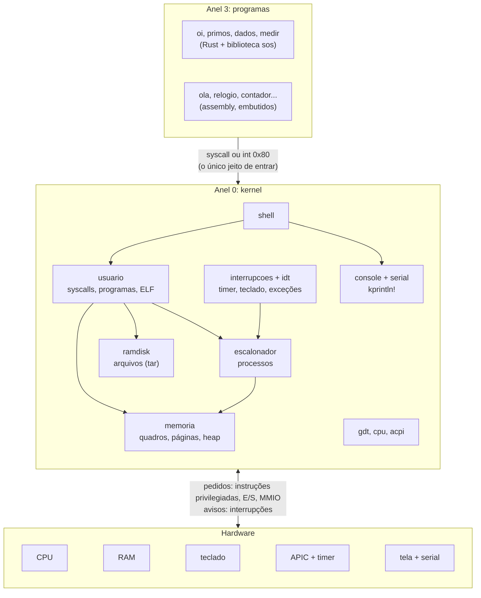
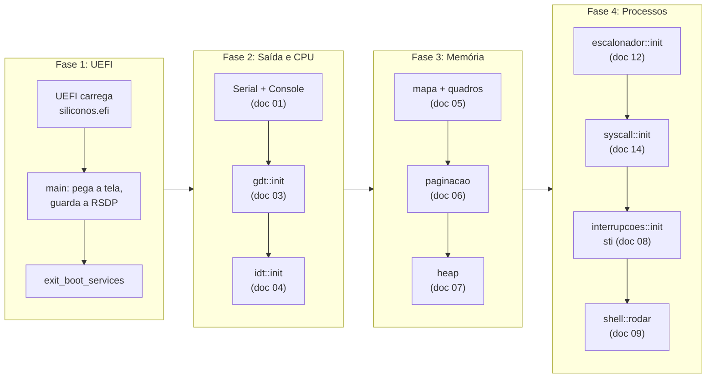
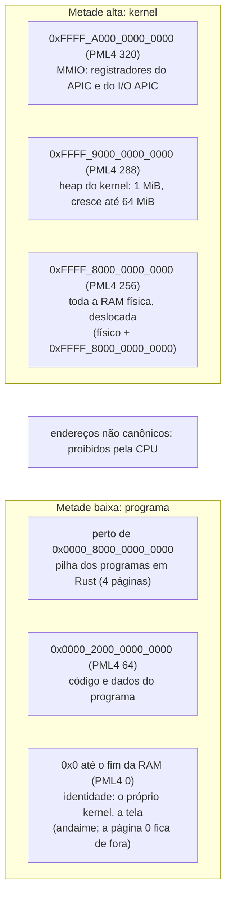
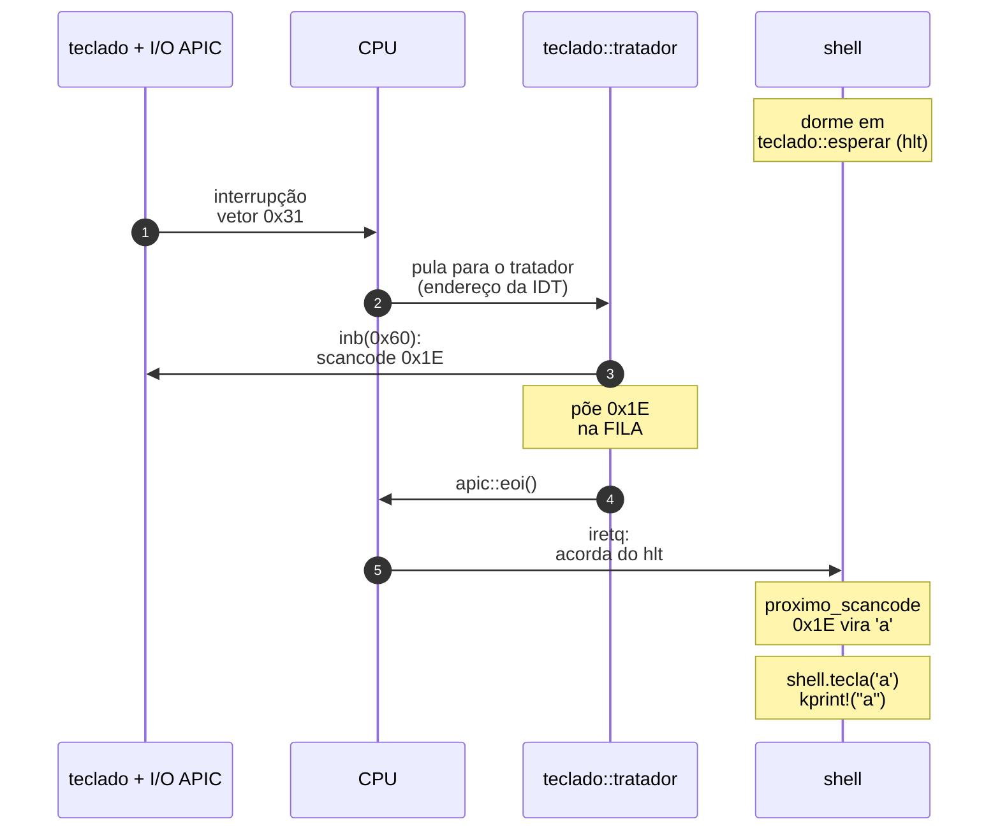
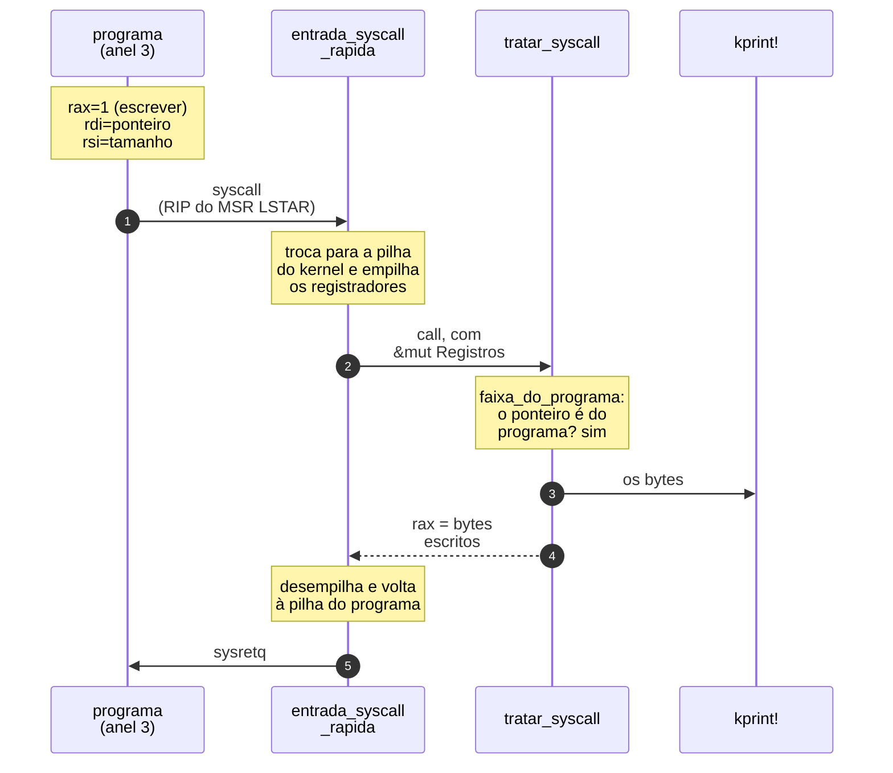
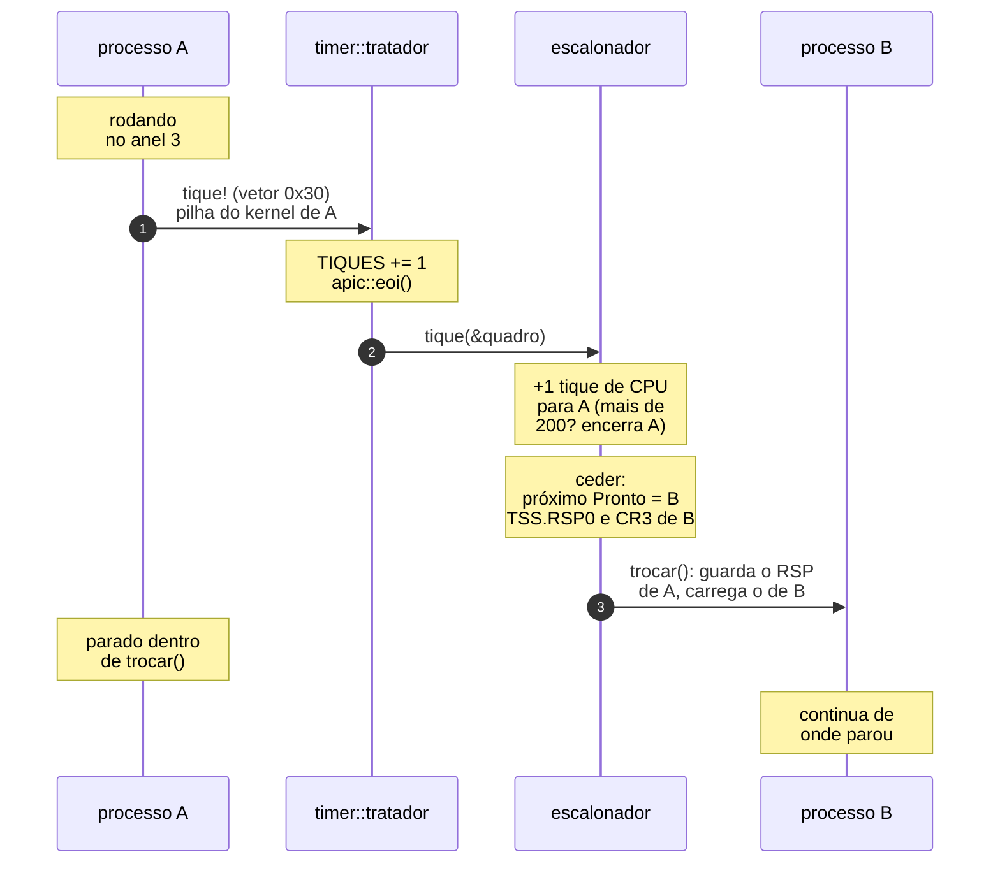
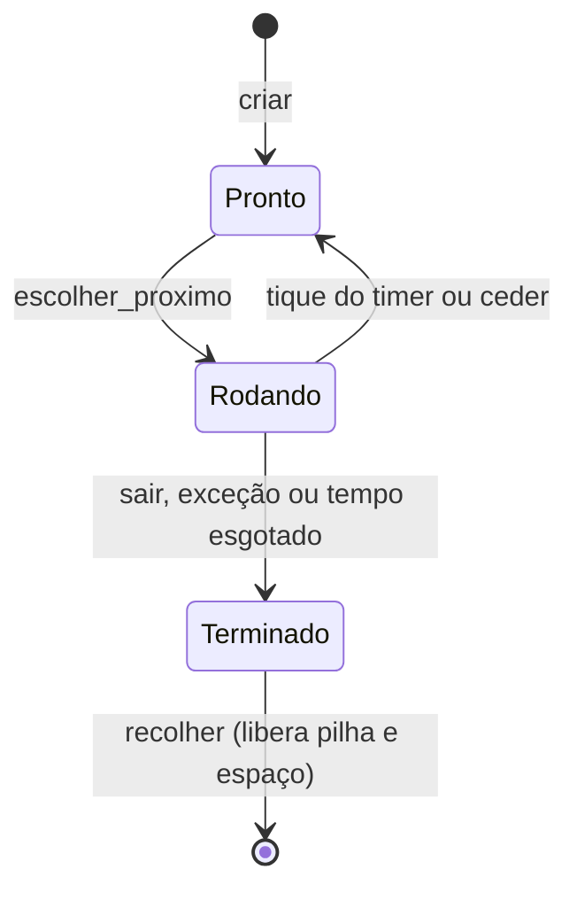
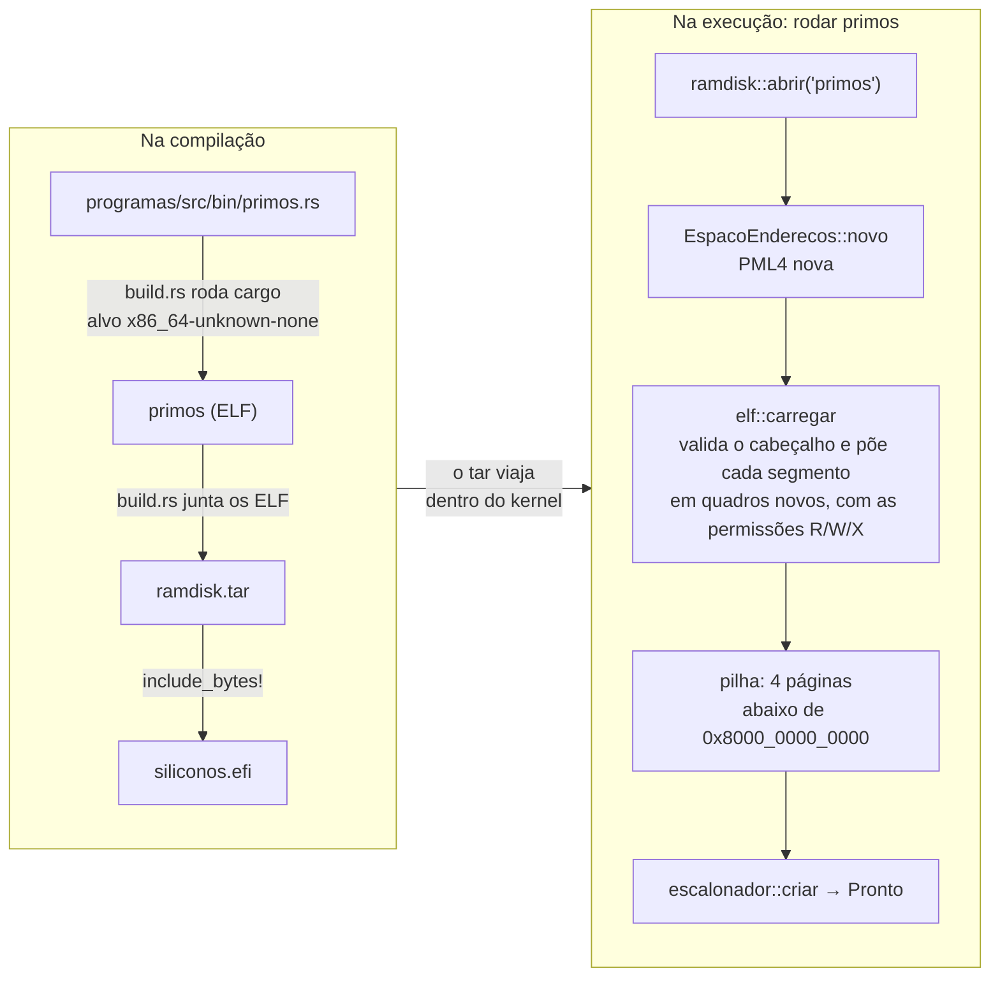

# Mapa do SiliconOS

Os capítulos contam a construção do sistema **na ordem em que ela aconteceu**:
primeiro a serial, depois a GDT, depois a memória... Esta página faz o
contrário. Ela mostra o sistema **pronto, como ele está agora**, e responde a
perguntas como:

- Quais são as peças (módulos) e qual é o trabalho de cada uma?
- Quem chama quem?
- O que acontece, passo a passo, quando você aperta uma tecla? E quando um
  programa chama `println!`? E quando o timer dispara?
- Onde cada coisa mora na memória?

Use esta página como um mapa: olhe o desenho, ache a peça que interessa e siga
o link para o capítulo que a explica em detalhe.

> **As outras referências**
>
> | Para saber... | Vá para |
> |---|---|
> | o que significa um termo de hardware ou de SO (TSS, PML4, EOI...) | [Glossário](glossario.md) |
> | o que significa um conceito de Rust (`Box`, `unsafe`, traits...) | [Rust para quem já programa](rust-basico.md) |
> | o que faz uma função específica, em uma frase | [Índice de funções](funcoes.md) |
> | por que uma peça foi feita de um jeito, com o código explicado | o capítulo dela (links abaixo) |

---

## 1. As camadas

Um sistema operacional é um intermediário: de um lado está o **hardware**
(CPU, memória, teclado, tela, relógio); do outro, os **programas**. O kernel
fica no meio. Os programas nunca tocam o hardware diretamente; eles **pedem**
ao kernel por meio de *chamadas de sistema* (syscalls).

As setas querem dizer "usa". Repare que **só o kernel** tem setas para o
hardware. Um programa que tentar falar com o hardware sozinho (por exemplo, o
programa `privilegiado`, que executa `hlt`) leva uma exceção e é encerrado: a
CPU não deixa o anel 3 fazer isso (doc [10](10-modo-usuario.md)).

---

## 2. Os módulos, um por um

Cada arquivo em `src/` é um **módulo** (o equivalente a um pacote ou classe
em outras linguagens). A coluna "Usa" lista os módulos que ele chama.

### Saída e diagnóstico

| Módulo | Trabalho | Usa | Doc |
|---|---|---|---|
| `main.rs` | Ponto de entrada. Conversa com o UEFI enquanto ainda pode, pega a tela e o mapa de memória, desliga o UEFI e chama o `init` de cada módulo na ordem certa. Define `kprintln!`. | todos | [00](00-visao-geral.md) |
| `serial.rs` | Escreve bytes na porta serial COM1. É a saída que sempre funciona, e é o que os testes leem. | nenhum | [01](01-saida-serial-e-video.md) |
| `console.rs` | Desenha texto na tela, pixel a pixel, com uma fonte de 8×8 pixels ampliada 2 vezes; rola a tela quando enche. | nenhum | [01](01-saida-serial-e-video.md) |
| `panic.rs` | O que fazer quando o kernel entra em pânico: imprime a mensagem e para a máquina. | `serial`, `qemu` | [02](02-panic-handler.md) |
| `qemu.rs` | Sai do QEMU com um código (usado pelos testes para dizer "passou" ou "falhou"). | `serial` | [09](09-shell-e-testes.md) |
| `testes.rs` | Roda os `#[test_case]` quando você executa `cargo test`. | `qemu` | [09](09-shell-e-testes.md) |

### A CPU

| Módulo | Trabalho | Usa | Doc |
|---|---|---|---|
| `gdt.rs` | Monta a GDT (os segmentos de código e dados do kernel e dos programas) e a TSS (as pilhas para onde a CPU pula numa interrupção). | nenhum | [03](03-gdt-e-tss.md), [12](12-escalonador.md) |
| `idt.rs` | Monta a IDT: a tabela que diz qual função trata cada exceção e interrupção. Tem os tratadores de exceção (divisão por zero, page fault...). | `gdt`, `interrupcoes`, `usuario` | [04](04-idt-e-excecoes.md) |
| `cpu.rs` | Instruções avulsas da CPU: `cpuid`, ler/escrever MSR, e `sem_interrupcoes` (roda um trecho com as interrupções desligadas). | `gdt`, `serial` | [08](08-interrupcoes-de-hardware.md), [14](14-syscall-sysret.md) |
| `acpi.rs` | Lê as tabelas ACPI do firmware para descobrir onde estão os controladores de interrupção, e desliga a máquina. | `paginacao`, `timer` | [08](08-interrupcoes-de-hardware.md) |

### Memória (`src/memoria/`)

| Módulo | Trabalho | Usa | Doc |
|---|---|---|---|
| `mapa.rs` | Converte o mapa de memória do UEFI numa lista própria: que faixas da RAM estão livres. | nenhum | [05](05-memoria-fisica.md) |
| `quadros.rs` | O alocador de **quadros**: entrega e recebe de volta páginas físicas de 4 KiB, com um bitmap (um bit por quadro). | `cpu` | [05](05-memoria-fisica.md) |
| `paginacao.rs` | As tabelas de página: mapear um endereço virtual num quadro físico, desmapear, traduzir; e `ativar` (trocar o CR3). | `quadros` | [06](06-paginacao.md), [11](11-espacos-de-enderecos.md) |
| `heap.rs` | O alocador do heap (`Box`, `Vec`, `String`): lista de blocos livres numa faixa virtual que cresce sob demanda. | `paginacao`, `cpu` | [07](07-heap.md) |
| `bump.rs` | Um alocador mais simples (só avança), mantido para comparação. | nenhum | [07](07-heap.md) |
| `espaco.rs` | `EspacoEnderecos`: as tabelas de página de **um** programa. Copia a parte do kernel e é dono dos quadros do programa; ao ser destruído, devolve tudo. | `paginacao`, `quadros` | [11](11-espacos-de-enderecos.md) |

### Interrupções (`src/interrupcoes/`)

| Módulo | Trabalho | Usa | Doc |
|---|---|---|---|
| `mod.rs` | Liga tudo: lê a ACPI, desliga o PIC antigo, configura o APIC e o I/O APIC, instala os tratadores e liga as interrupções (`sti`). | `acpi`, `idt`, `cpu` | [08](08-interrupcoes-de-hardware.md) |
| `pic.rs` | Desliga o 8259 (o controlador de interrupções antigo). | `serial` | [08](08-interrupcoes-de-hardware.md) |
| `apic.rs` | O APIC local: o controlador de interrupções de cada CPU; inclui o EOI ("terminei de tratar"). | `cpu`, `paginacao` | [08](08-interrupcoes-de-hardware.md) |
| `ioapic.rs` | O I/O APIC: roteia as interrupções dos dispositivos (teclado...) para a CPU. | `paginacao` | [08](08-interrupcoes-de-hardware.md) |
| `timer.rs` | O relógio: 100 tiques por segundo. A cada tique, avisa o escalonador. Também lê o relógio CMOS (RTC). | `apic`, `escalonador` | [08](08-interrupcoes-de-hardware.md), [12](12-escalonador.md) |
| `teclado.rs` | Recebe os *scancodes* do teclado numa fila e os traduz em caracteres (layout US). | `apic` | [08](08-interrupcoes-de-hardware.md) |

### Processos e programas

| Módulo | Trabalho | Usa | Doc |
|---|---|---|---|
| `escalonador.rs` | A tabela de processos e a **troca de contexto**: decide quem roda, troca de pilha, de CR3 e de TSS.RSP0. Cria, encerra e recolhe processos. | `memoria`, `gdt`, `timer`, `usuario` | [12](12-escalonador.md) |
| `usuario/mod.rs` | Prepara um programa (espaço, código, pilha) e o entrega ao escalonador. Trata as syscalls (`tratar_syscall`) e as falhas dos programas. | `escalonador`, `memoria`, `timer` | [10](10-modo-usuario.md), [12](12-escalonador.md), [13](13-disco-em-ram-e-elf.md) |
| `usuario/syscall.rs` | A porta rápida para o kernel: configura os MSRs da instrução `syscall` e tem a entrada `entrada_syscall_rapida`. | `cpu`, `gdt`, `usuario` | [14](14-syscall-sysret.md) |
| `usuario/elf.rs` | Lê arquivos ELF (o formato dos executáveis) e carrega os segmentos no espaço do programa. | `memoria`, `usuario` | [13](13-disco-em-ram-e-elf.md) |
| `usuario/programas.rs` | Os programas antigos, escritos em assembly e embutidos no kernel. | nenhum | [10](10-modo-usuario.md) |
| `ramdisk.rs` | O "disco": um arquivo tar com os programas em Rust, embutido no kernel na compilação. | nenhum | [13](13-disco-em-ram-e-elf.md) |
| `shell.rs` | O interpretador de comandos: lê teclas, monta a linha e executa o comando (`ajuda`, `rodar`, `ps`...). | quase todos | [09](09-shell-e-testes.md) |

E fora de `src/`:

| Onde | Trabalho | Doc |
|---|---|---|
| `build.rs` | Antes de compilar o kernel, compila os programas de `programas/` e junta os executáveis num arquivo tar. | [13](13-disco-em-ram-e-elf.md) |
| `programas/` | Os programas de usuário em Rust e a biblioteca `sos` que eles usam para falar com o kernel. | [13](13-disco-em-ram-e-elf.md), [14](14-syscall-sysret.md) |

---

## 3. A ligação: a ordem de inicialização

O kernel começa em `main.rs` e liga as peças **numa ordem obrigatória**: cada
uma depende das anteriores. Por exemplo, o heap precisa da paginação (para
mapear as páginas dele), que precisa do alocador de quadros (para ter de onde
tirar as tabelas), que precisa do mapa da memória.

Por que as interrupções são ligadas quase por último? Porque o tratador do
timer chama o escalonador, que usa o heap, que usa a paginação. Se o timer
disparasse antes de essas peças existirem, o kernel cairia.

---

## 4. Onde cada coisa mora: o espaço de endereços

Todo endereço que o código usa é **virtual**. As tabelas de página traduzem
cada um para um endereço **físico** da RAM. A metade de cima (endereços que
começam com `0xFFFF...`) é do kernel e é igual em todos os processos; a
metade de baixo muda a cada programa.

O mapeamento "identidade" (virtual = físico) da PML4 0 existe porque o UEFI
carregou o kernel num endereço baixo e ele ainda roda lá. Cada programa
recebe uma cópia das entradas presentes da PML4 do kernel (0, 256, 288 e 320),
mas só com o bit USUARIO nas páginas dele: se o programa tentar ler o kernel,
leva um page fault (doc [11](11-espacos-de-enderecos.md)).

---

## 5. O caminho de uma tecla

Você aperta `a` no teclado. Até a letra aparecer na tela:

Dois detalhes importantes:

- **O tratador é curto.** Ele só lê o byte e o põe na fila; quem traduz é o
  shell, fora da interrupção. Um tratador demorado atrasaria todo o resto
  (doc [08](08-interrupcoes-de-hardware.md)).
- **A fila não tem lock.** Um lado só escreve (o tratador), o outro só lê (o
  shell); os índices são atômicos. Um lock aqui poderia travar a máquina se a
  interrupção chegasse com o lock pego.

---

## 6. O caminho de uma syscall

Um programa em Rust chama `println!("oi")`. A biblioteca `sos` transforma isso
na syscall `escrever` (número 1):

Os programas antigos em assembly fazem o mesmo caminho por `int 0x80`
(entrada `entrada_syscall`, que termina com `iretq`). As duas entradas montam
a **mesma** struct `Registros` e chamam o **mesmo** `tratar_syscall`; só a
porta é diferente. A `syscall` é cerca de 3 a 4 vezes mais rápida (doc
[14](14-syscall-sysret.md)).

As syscalls que existem hoje:

| Número | Nome | Argumentos | Devolve |
|---|---|---|---|
| 0 | `sair` | código de saída | não volta |
| 1 | `escrever` | ponteiro, tamanho | bytes escritos (ou erro) |
| 2 | `tiques` | nenhum | tiques desde o boot (100 por segundo) |
| 3 | `pid` | nenhum | o número do processo |

---

## 7. O timer e a troca de processo

100 vezes por segundo o timer interrompe quem estiver rodando. É assim que
vários programas parecem rodar ao mesmo tempo numa CPU só:

Quando chegar a vez de A de novo, algum outro processo chama `trocar` para
A, e A "retorna" de `trocar` como se nada tivesse acontecido: volta para
`tique`, para o tratador do timer, e o `iretq` final o leva de volta ao anel 3.

---

## 8. A vida de um processo

`criar` é chamada por `usuario::iniciar` (programas embutidos) ou
`usuario::iniciar_elf` (programas do disco). Um processo `Terminado` ainda ocupa memória (é um "zumbi") até alguém
**recolher** o resultado: o shell, quando o programa roda em primeiro plano
(`escalonador::esperar`), ou o laço do shell, para os de segundo plano
(`rodar X &`). Ao recolher, o `Drop` da pilha e do `EspacoEnderecos` devolve
os quadros ao alocador.

---

## 9. Do código-fonte ao programa rodando

Como `programas/src/bin/primos.rs` vira um processo:

---

## 10. Como manter este mapa

Cada capítulo novo que mudar uma destas figuras atualiza esta página. O
[Índice de funções](funcoes.md) não precisa disso: ele é gerado
automaticamente, a partir das tabelas "Funções deste capítulo", toda vez que
o site é publicado.
